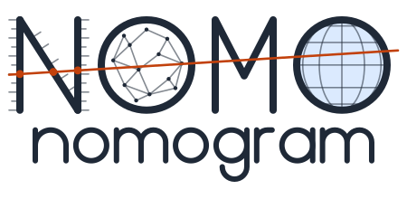
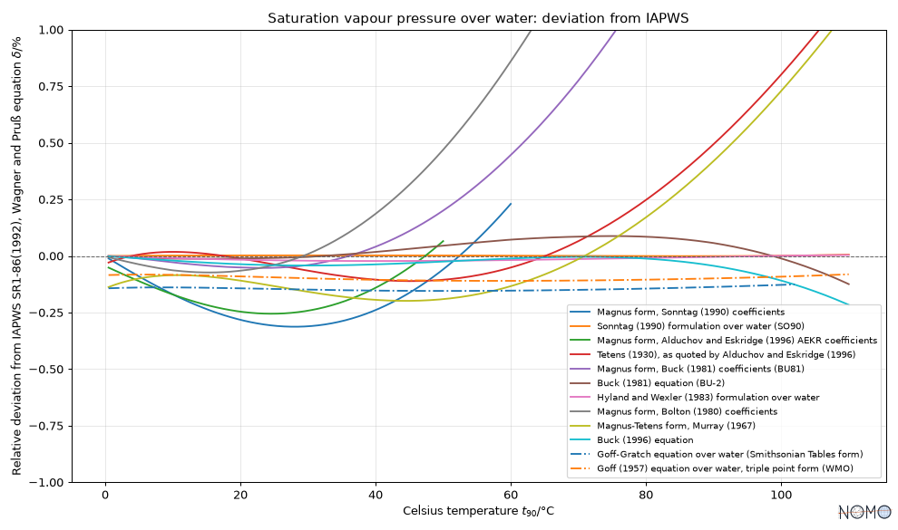

<p align="center">
  <picture>
    <source media="(prefers-color-scheme: dark)" srcset="docs/images/banner-dark.svg">
    
  </picture>
</p>

[English](README.md) | **Français**

[](https://github.com/miki4iaml/nomogram/actions/workflows/ci.yml)
[](https://github.com/miki4iaml/nomogram/actions/workflows/github-code-scanning/codeql)
[](https://codecov.io/gh/miki4iaml/nomogram)
[](pyproject.toml)
[](LICENSE)
[](https://doi.org/10.5281/zenodo.23373134)
[](https://github.com/astral-sh/uv)
[](https://github.com/astral-sh/ruff)
[](https://mypy-lang.org/)
[](https://www.conventionalcommits.org/en/v1.0.0/)

**Les formules comme données, pas comme code.**

nomogram ne code pas de fonctions en dur : il catalogue des formules,
chacune

- **signifiante** : kinds et unités de QUDT, liens vers CF et Wikidata,
  sa source, son domaine de validité quand il est indiqué ;
- **vérifiée** : dimensions et unités au chargement, équivalences
  prouvées symboliquement, valeurs recoupées avec des références ;
- **prête à l'emploi** : calculer, composer, inverser, tracer, et
  comparer à ses alternatives.

Conçu pour la confiance, pas pour la vitesse : montrer qu'un calcul est
juste, et d'où il vient.

En Python pur, fondé sur SymPy, numpy et pint ; il fonctionne sur un
poste déconnecté (aucun moteur en ligne).

> Projet à un stade précoce (alpha).

## Installation

```
pip install nomogram          # cœur
pip install "nomogram[viz]"   # avec les tracés (matplotlib)
```

## Installation depuis les sources

```
git clone https://github.com/miki4iaml/nomogram.git
cd nomogram
uv sync
```

Python 3.12 ou plus récent. Les tracés demandent l'extra `viz`
(matplotlib) : `uv sync --extra viz`.

## Exemple

Toutes les formulations de la pression de vapeur saturante du catalogue
comparées à la référence IAPWS ; les courbes s'arrêtent là où une
formulation sort de son domaine de validité déclaré
([script](docs/examples/saturation_vapour_pressure.py)) :

```python
import numpy as np
import nomogram as nomo
from nomogram.units import Q_

catalog = nomo.catalog.catalog()
formulations = catalog.formulations_of("SaturationVapourPressureOverWater")
reference = catalog.formulations["iapws_sr1_86"]
temperatures = Q_(np.linspace(-60, 110, 341), "degC")

table = nomo.comparison.compare(
    formulations, reference, {"ThermodynamicTemperature": temperatures}
)
nomo.plot.plot_deviations(table)  # extra viz
```



## Utilisation

La table contient les valeurs et les écarts relatifs, par formulation ;
hors du domaine de validité d'une formulation, les valeurs valent NaN
sauf demande contraire (`outside="ignore"`). Les formulations se
composent aussi, par exemple l'humidité absolue à partir de n'importe
quelle formulation de la pression de vapeur saturante :

```python
ha = nomo.comparison.compose(
    catalog.formulations["mass_concentration_ideal_gas"], {"e_s": reference}
)
ha.evaluate(RH=Q_(100, "percent"), T=Q_(20, "degC")).to("g/m^3")  # 17,29
```

Les formulations se retrouvent par mots, jokers et champs, quelle que
soit leur notation ([Finding formulations](docs/search.md), en anglais) :

```python
catalog.search(variable="rho*")                    # ρ dans toutes les notations
catalog.search(kind="VapourPressure", source="buck*")
```

Chaque formulation garde ses unités, son domaine de validité, son
échelle de température et ses références. Le vocabulaire est mis en
correspondance dans [docs/rosetta.md](docs/rosetta.md) (en anglais) ; la
page [How nomogram earns trust](docs/approach.md) (en anglais) explique ce
qui est vérifié, et comment, et [Displaying formulas](docs/display.md) (en
anglais) montre l'affichage des formules dans un notebook, en Markdown et
sur un graphique. [Sea water](docs/sea-water.md) (en anglais) présente les
échelles de salinité et la pression de vapeur de l'eau de mer, et ce que
son abaissement de 2 % change à la surface de la mer. [Le logo](docs/logo.md)
(en anglais) est un vrai nomogramme.

## Contribuer

Références à intégrer, compléments ou corrections sur les entrées du
catalogue, nouvelles formules et code sont tous bienvenus : voir
[comment contribuer](.github/CONTRIBUTING.fr.md#comment-contribuer)
(version anglaise de référence : [CONTRIBUTING.md](.github/CONTRIBUTING.md))
et le [guide du catalogue](docs/catalog.md) (en anglais).

## Sources des données

Les unités de nomogram viennent de QUDT, comme ses natures de grandeur,
sauf celles que QUDT ne définit pas : nomogram les définit comme
spécialisations de natures de grandeur QUDT. nomogram relie certaines
natures de grandeur à des noms standard CF, repris avec leurs unités
canoniques de la table des noms standard CF. Le paquet embarque un
sous-ensemble de chaque source :

- QUDT — Quantities, Units, Dimensions and Types, par QUDT.org
  (<https://qudt.org>), version 3.5.2, sous licence
  [CC BY 4.0](https://creativecommons.org/licenses/by/4.0/) ;
- la [table des noms standard CF](https://cfconventions.org/Data/cf-standard-names/95/build/cf-standard-name-table.html),
  version 95, [CC0 1.0](https://creativecommons.org/publicdomain/zero/1.0/) ;
- les codes UCUM des unités, tels que QUDT les donne : © Regenstrief
  Institute, Inc., [licence UCUM](https://ucum.org/license).

Ce que nomogram sélectionne, modifie et ajoute est détaillé dans
[NOTICE.md](src/nomogram/data/NOTICE.md) (en anglais).

## Licence

Code : [BSD-3-Clause](LICENSE). Données embarquées : voir
[Sources des données](#sources-des-données).
