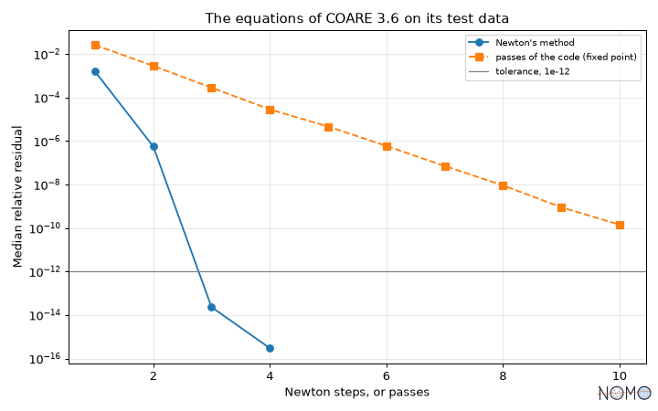

# The loop of COARE 3.6, solved as a system of equations

- Reference: the COARE 3.6 bulk flux algorithm, Python version
  (NOAA-PSL/COARE-algorithm, commit `bd1cac8` of 2026-03-17, MIT licence),
  its test data and its outputs, one row in 20 (109 rows). Thanks to the
  NOAA Physical Sciences Laboratory for publishing the algorithm with the
  data that test it.
- Computed with the development version of nomogram 0.8 on 2026-11-21;
  the tests compute every value of this page again for each later
  version, and fail if one changes.

COARE 3.6 computes the fluxes of momentum, heat and water vapour between
the sea and the air from the measurements of a ship. At its heart is a
loop: the scales of the surface layer give the Obukhov length, which
gives the roughness lengths, which give the scales again, ten times over.
nomogram writes this loop with formulations of its catalog, each cited
from the code or from the paper behind it, as one system of equations,
`coare36_surface_layer`, and solves it. Given the inputs the code
computes, the system gives back the outputs of the code to a few
millionths.

## The system

Thirteen equations, in the order of the code, as nomogram writes them
(the coefficients by their names in the catalog, ψ the profile
functions of COARE):

| | Equation | Gives | Formulation |
|---|---|---|---|
| 1 | $`L = \frac{T u_*^{2}}{g k \left(T c q_* + \theta_*\right)}`$ | Obukhov length | `coare36_obukhov_length` |
| 2 | $`z_0 = \frac{\alpha u_*^{2}}{g} + \frac{\gamma \nu}{u_*}`$ | roughness length | `edson2013_roughness_length_momentum` |
| 3 | $`R_{\mathrm{r}} = \frac{u_* z_0}{\nu}`$ | roughness Reynolds number | `roughness_reynolds_number` |
| 4 | $`z_{0q} = \left\{A \;\mathrm{if}\; R_{\mathrm{r}} \leq R_{\mathrm{x}},\; B R_{\mathrm{r}}^{- p} \;\mathrm{if}\; R_{\mathrm{r}} > R_{\mathrm{x}}\right.`$ | roughness length for humidity | `coare36_roughness_length_humidity` |
| 5 | $`z_{0\theta} = \left\{A \;\mathrm{if}\; R_{\mathrm{r}} \leq R_{\mathrm{x}},\; B R_{\mathrm{r}}^{- p} \;\mathrm{if}\; R_{\mathrm{r}} > R_{\mathrm{x}}\right.`$ | roughness length for temperature | `coare36_roughness_length_heat` |
| 6 | $`u_* = \frac{S k}{- \psi_{\mathrm{u}}\left(\frac{z_{\mathrm{u}}}{L}\right) + \ln{\left(\frac{z_{\mathrm{u}}}{z_0} \right)}}`$ | friction velocity, **unknown** | `coare36_friction_velocity` |
| 7 | $`q_* = - \frac{k \left(- q + q_0\right)}{- \psi_{\mathrm{t}}\left(\frac{z_{\mathrm{q}}}{L}\right) + \ln{\left(\frac{z_{\mathrm{q}}}{z_{0q}} \right)}}`$ | humidity scale, **unknown** | `coare36_humidity_scale` |
| 8 | $`\theta_* = - \frac{k \left(- T + T_0 - \frac{g z_{\mathrm{t}}}{c_{\mathrm{pa}}}\right)}{- \psi_{\mathrm{t}}\left(\frac{z_{\mathrm{t}}}{L}\right) + \ln{\left(\frac{z_{\mathrm{t}}}{z_{0\theta}} \right)}}`$ | temperature scale, **unknown** | `coare36_temperature_scale` |
| 9 | $`Q_{\mathrm{0v}} = - u_* \left(T c q_* + \theta_* \left(c q + 1\right)\right)`$ | virtual temperature flux | `coare36_virtual_temperature_flux` |
| 10 | $`w_g = \left\{\beta \left(\frac{Q_{\mathrm{0v}} g z_{\mathrm{i}}}{T}\right)^{0.333} \;\mathrm{if}\; Q_{\mathrm{0v}} > 0,\; u_{0} \;\mathrm{if}\; Q_{\mathrm{0v}} \leq 0\right.`$ | gustiness velocity | `coare36_convective_gust` |
| 11 | $`S = \sqrt{U^{2} + w_g^{2}}`$ | wind speed with gustiness, **unknown** | `coare36_wind_speed_with_gust` |
| 12 | $`U_{\mathrm{10N}} = \frac{U u_* \ln{\left(\frac{z_{10}}{z_0} \right)}}{S k}`$ | neutral wind at 10 m | `coare36_equivalent_neutral_wind_10m` |
| 13 | $`\alpha = \left\{U_{\mathrm{10N}} a_{1} + a_{2} \;\mathrm{if}\; U_{\mathrm{10N}} \leq U_{\mathrm{max}},\; U_{\mathrm{max}} a_{1} + a_{2} \;\mathrm{if}\; U_{\mathrm{10N}} > U_{\mathrm{max}}\right.`$ | Charnock coefficient, **unknown** | `coare36_charnock_coefficient` |

Five variables are read before they are computed in a pass: the
friction velocity $`u_*`$, the scales $`q_*`$ and $`\theta_*`$, the wind
speed with gustiness $`S`$ and the Charnock coefficient $`\alpha`$. They
are the unknowns of the system. The other eight follow from them and
from the eleven inputs: the temperature and humidity of the air ($`T`$,
$`q`$) and of the sea surface ($`T_0`$, $`q_0`$), the wind $`U`$, the
heights of measurement, the height of the boundary layer, the viscosity
of air $`\nu`$ and the gravity $`g`$.

## Its solution

Solving the system means finding the five unknowns for which the
thirteen equations hold together. nomogram finds them by Newton's
method in three steps for most measurements, four at most, until every
equation holds to 10⁻¹² of the size of its terms; the ten passes of the
code stop at about 10⁻¹⁰.

## Against the code

The values of the code and of nomogram for the first measurement of the
test data, which gives the system its eleven inputs, $`T`$, $`q`$,
$`T_0`$, $`q_0`$, $`U`$, $`z_{\mathrm{u}}`$, $`z_{\mathrm{t}}`$,
$`z_{\mathrm{q}}`$, $`z_{\mathrm{i}}`$, $`\nu`$ and $`g`$ (a wind of
12.1 m/s), and the relative deviations over its 109 measurements. The
inputs are those the code computes itself: its humidity, with the
enhancement factor of Buck, its gravity and its viscosity of air.

| Variable | In the code | COARE, first measurement | nomogram, first measurement | Largest deviation | Median deviation |
|---|---|---|---|---|---|
| friction velocity u\* (m/s) | `usr` | 0.4491899 | 0.4491901 | 5.6 × 10⁻⁷ | 1.3 × 10⁻⁷ |
| humidity scale q\* (kg/kg) | `qsr` | −0.00017966 | −0.00017966 | 1.8 × 10⁻⁶ | 4.2 × 10⁻⁷ |
| temperature scale θ\* (K) | `tsr` | −0.01448473 | −0.01448485 | 5.3 × 10⁻⁵ | 3.4 × 10⁻⁶ |
| Obukhov length L (m) | `L` | −326.2426 | −326.2422 | 7.4 × 10⁻⁶ | 1.3 × 10⁻⁶ |
| roughness length z₀ (m) | `zo` | 0.0003085017 | 0.0003085021 | 1.5 × 10⁻⁶ | 2.3 × 10⁻⁷ |
| gustiness velocity (m/s) | `gust` | 0.897408 | 0.897409 | 2.6 × 10⁻⁶ | 5.5 × 10⁻⁷ |

The temperature scale, from −0.10 K to −0.002 K, small against the
differences of temperature it comes from, follows the skin temperature
of the data, given to seven digits.

## What it leaves out

The system is the loop of the code over the formulations of the
catalog, as its note in the catalog states:

- the cool skin and the warm layer: the surface temperature and humidity
  are inputs, the skin temperature and the humidity at the surface of
  the outputs of the code;
- the Charnock coefficient from the waves: the test data have none;
- the first pass the code keeps where its first guess is very stable
  (ζ above 50), and the roughness length over ice;
- a stable case: the test data are all unstable, L from −326 m to
  −4.5 m.

The first guess is simpler than the code's, so that only the converged
values are compared. [The evaporation duct](evaporation-duct.md) calls
this system on the way to the height of the duct.

The script [docs/examples/coare_system.py](examples/coare_system.py)
computes every value of this page and draws the figure.
