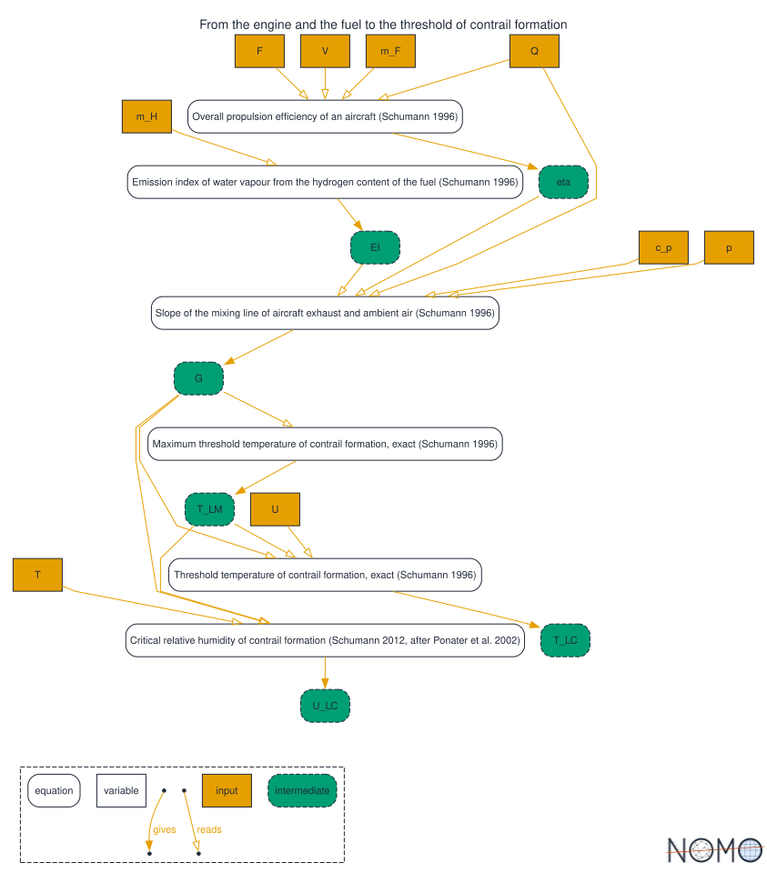
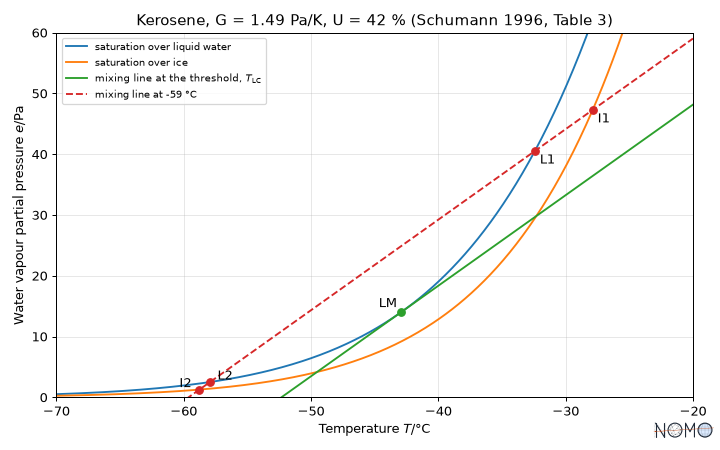
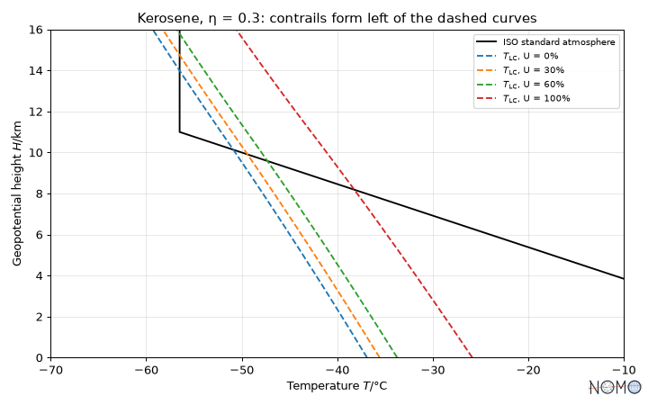
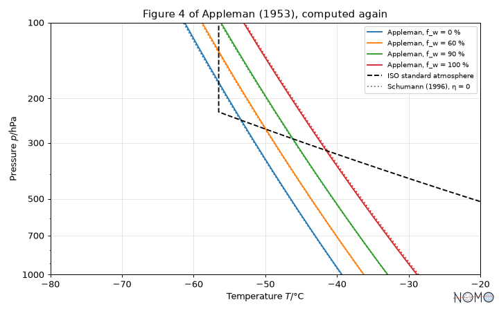
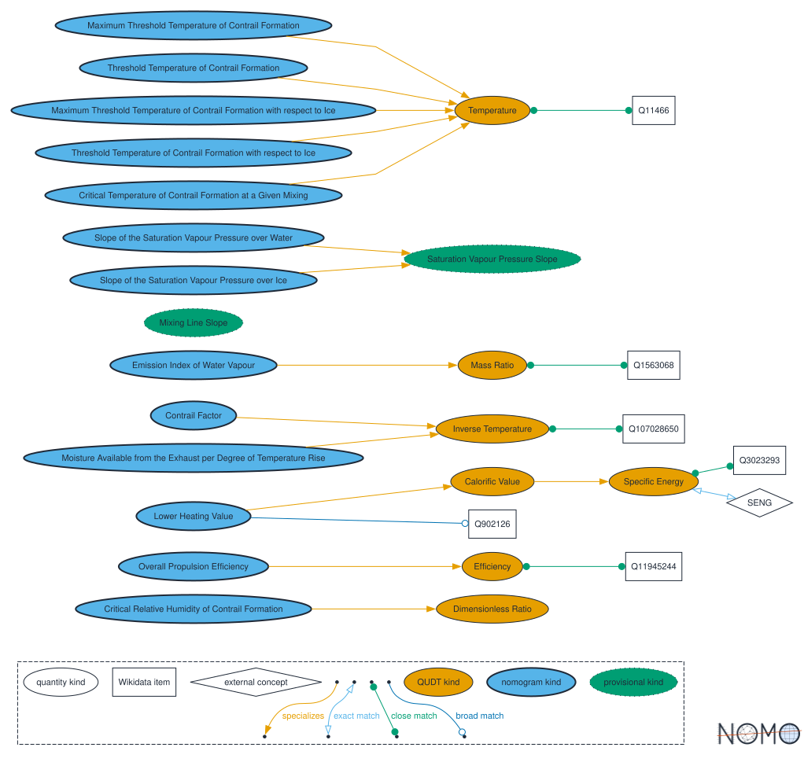

# Contrails: when the exhaust of an aircraft saturates the air

- Sources: Schumann (1996, 2000, 2012), Gierens (2021), Ponater et al.
  (2002) and Appleman (1953), read in their pages; the values they print
  are the oracles of this page. Thanks to the authors of pycontrails
  (Contrails.org), whose functions cross-check the fit of the maximum
  threshold temperature and the saturation vapour pressure of Schumann
  (2012) and its slope (`pycontrails0661_sac`, `pycontrails0661_sonntag`),
  and whose code helped to read the criterion.
- Computed with nomogram on 2026-11-25, after its version 0.9.0; the
  tests compute every value of this page again for each later version,
  and fail if one changes.

Hot and moist, the exhaust of an aircraft mixes with the colder air
around it. In a diagram of water vapour partial pressure against
temperature, the mixtures lie on a straight line from the exhaust to the
ambient air, the mixing line, whose slope G depends on the fuel, the
engine and the pressure (Schumann 1996, equation 8). A contrail forms
when that line crosses the saturation curve over liquid water: water
droplets form, and freeze quickly at the low temperatures of the upper
troposphere (Schumann 1996). This is the criterion of
Schmidt and Appleman. The family `contrail` of the catalog holds it, as
Appleman (1953), Schumann (1996, 2000, 2012) and Gierens (2021) write it.

## The criterion in brief

- The slope of the mixing line: `schumann1996_mixing_line_slope`,
  G = EI c_p p / [ε Q (1 − η)], from the emission index of water vapour
  EI, the lower heating value Q of the fuel and the overall propulsion
  efficiency η of the aircraft (`schumann1996_emission_index_water_vapour`,
  `schumann1996_overall_propulsion_efficiency`).
- The maximum threshold temperature T_LM, where the mixing line touches
  the saturation curve, their slopes equal (equation 10):
  `schumann1996_maximum_threshold_temperature_liquid`, an implicit equation
  calling the slope of the saturation vapour pressure of Schumann (2012),
  a derivative of the catalog. Its fits: equation 31 of Schumann (1996),
  and Gierens (2021).
- The threshold temperature T_LC at the relative humidity U of the
  ambient air (equation 11): `schumann1996_threshold_temperature_liquid`.
  The equation has a second root, above T_LM, which is no threshold: a
  relative bound of its physical domain, T_LC ≤ T_LM, leaves it out of the
  search for the root ([the catalog guide](catalog.md#formulations)). At
  U = 1 the two roots meet at T_LM, a double root, without a change of
  sign, which the search takes on that end. The fit of Schumann (2012),
  `schumann2012_threshold_temperature_fit`, avoids the iteration.
- The same over ice: T_IM and T_IC (equations 10 and 12).
- The critical relative humidity U_LC of Schumann (2012, equation 12),
  after Ponater et al. (2002): the humidity above which contrails form at
  an ambient temperature below T_LM, which Ponater et al. state and the
  default evaluation applies. Negative where even dry air gives contrails:
  not a relative humidity, a kind of its own.

From the engine and the fuel to the threshold, the formulations follow
one another, each reading what the ones before give; the implicit
equations also call the saturation vapour pressure of Schumann (2012) and
its slope, which the figure leaves out. Drawn by protee, as a system
without a loop built for the figure
([`graph_figures.py`](examples/graph_figures.py)):

<picture>
  <source media="(prefers-color-scheme: dark)" srcset="images/contrail-chain-dark.svg">
  
</picture>

Three systems without a loop chain the equations, each solved in turn:
exact over liquid water (`schumann1996_threshold_temperature`), over ice
(`schumann1996_threshold_temperature_ice`), and by the fits, the way of
Schumann (2012) at each waypoint (`schumann2012_threshold_temperature`).
For the conditions of Table 3 of Schumann (1996), kerosene behind a B747
at 220 hPa, G = 1.49 Pa/K and U = 42 %:

```python
exact = c.systems["schumann1996_threshold_temperature"]
over_ice = c.systems["schumann1996_threshold_temperature_ice"]
liquid = exact.evaluate(G=Q_(1.49, "Pa/K"), U=Q_(0.42, ""))
ice = over_ice.evaluate(G=Q_(1.49, "Pa/K"), U=Q_(0.42, ""))
```

T_LM = −42.91 °C, T_LC = −50.64 °C, T_IM = −39.76 °C and
T_IC = −45.67 °C, where Table 3 prints −42.9, −50.6, −39.8 and −45.7 °C.

## The diagram of Schmidt and Appleman



The mixing line at the threshold touches the curve over liquid water at
LM. Ambient air colder than T_LC, here at −59 °C as in Table 3, gives a
line of the same slope G, parallel to the tangent and shifted towards
colder temperatures: it crosses the curves twice. The
diluting plume reaches ice saturation at I1, water saturation at L1, and
stays saturated until its mixing reaches L2 and I2 (Schumann 1996, p. 11).
These crossings, solutions
of equations 13 and 14 with two physical roots each, are not in the
catalog: the script of this page finds them by bisection, at −32.42,
−57.93, −27.88 and −58.77 °C, where Table 3 prints −32.4, −58.0, −27.9
and −58.8 °C. An equation with several physical roots awaits the
solution sets of a later version.

## Along the standard atmosphere

The slope G grows with the pressure, and so do the threshold
temperatures. Along the ISO standard atmosphere, the pressure of
ITU-R P.835 feeds the mixing line, which feeds the two implicit
equations, in one composition:

```python
slope = compose(
    f["schumann1996_mixing_line_slope"], {"p": f["itu_r_p835_pressure"]}
)
maximum = compose(
    f["schumann1996_maximum_threshold_temperature_liquid"], {"G": slope}
)
threshold = compose(
    f["schumann1996_threshold_temperature_liquid"], {"T_LM": maximum, "G": slope}
)
kerosene: dict[str, Any] = {
    "EI": Q_(1.25, "kg/kg"),
    "c_p": Q_(1004, "J/(kg*K)"),
    "Q": Q_(43, "MJ/kg"),
    "eta": Q_(0.3, ""),
}
h = Q_(np.linspace(0, 16, 1601), "km")  # geopotential height
air = f["itu_r_p835_temperature"].evaluate(H=h).to("degC").magnitude
by_humidity = {
    u: threshold.evaluate(H=h, U=Q_(u, ""), **kerosene).to("degC").magnitude
    for u in HUMIDITIES
}
```



This is Figure 4a of Schumann (1996) computed again. Contrails form where
the air is colder than the threshold: in dry air from 10.1 to 14.0 km,
"below 14 km" for a dry stratosphere as Schumann writes; at 30 % from
9.9 km, at 60 % from 9.6 km, and at 100 % from 8.2 km, where Schumann
writes "above 8.4 km", 0.2 km higher.

## Where contrails persist

A contrail that forms evaporates within seconds or minutes unless the
ambient air is supersaturated with respect to ice: "Persistent contrails
are expected to form in regions where contrails lead to water saturation
and where the ambient humidity exceeds ice saturation" (Schumann 1996,
p. 10). Over water, ice saturation is a relative humidity of
e_I(T)/e_L(T): 74.5 % at −30 °C, 67.4 % at −40 °C, 61.1 % at −50 °C. With
the critical relative humidity of the formation, the two curves divide
the plane of temperature and humidity:

```python
ambient = Q_(np.linspace(-70.0, -35.0, 3501), "degC")
formation = f["schumann2012_critical_relative_humidity"].evaluate(
    T=ambient, T_LM=liquid["T_LM"], G=Q_(1.49, "Pa/K")
)
ice_saturation = (p_ice.evaluate(T=ambient) / p_liq.evaluate(T=ambient)).to("")
```


For the kerosene of Table 3, the formation threshold meets ice saturation
at −49.5 °C. Between −49.5 °C and T_LM, −42.91 °C, every contrail that
forms persists, while air supersaturated over ice but drier than the
threshold gets none; colder, contrails also form in air subsaturated over
ice, and vanish quickly; below −52.3 °C, even dry air gives contrails.
Above T_LM, no humidity gives contrails. The persistence is a margin here,
read on the figure: a predicate of the catalog, an inequality, awaits the
solution sets of a later version.

## Appleman's criterion, 1953

Appleman (1953) reasons in mixing ratios. Each gram of fuel burnt gives
about 12 g of exhaust gases, 1.4 g of water vapour and 10 000 cal: for
each degree the mixture warms, the
exhaust adds 0.0336 g of water per kilogram of air, "independent of the
value of N", the dilution (`appleman1953_available_moisture`). Part of it
saturates the ambient air, the rest is available to keep the mixture
saturated as it warms. Where the available moisture equals what a
saturated mixture needs, he finds the critical temperature for a given
mixing (`appleman1953_critical_temperature_fixed_mixing`), from his tables
and the intersection of their curves (Figure 1). He prints no equation for
it, nor the saturation vapour pressure he takes: the entry writes the
equality of the two with the Goff-Gratch equation and ε = 0.622, which
reproduce his Tables I and II, as assumptions to check. The highest
critical temperature over the mixing is his Figure 4:

```python
critical = f["appleman1953_critical_temperature_fixed_mixing"]
rise = Q_(np.geomspace(0.5, 60, 121), "K")
t_c = critical.evaluate(
    f_w=Q_(f_w, "percent"),
    p=Q_(pressures[:, np.newaxis], "hPa"),
    dT=rise,
    outside="ignore",
)
```



The Goff-Gratch equation over water stops at −50 °C: below, the default
evaluation gives NaN, and `outside="ignore"` goes on, as Appleman's tables
do down to −80 °C. His temperatures are taken on IPTS-48, inferred from
the date, and converted to ITS-90 by the table of Douglas (1969): +0.03 K
near −40 °C.

Appleman proposes his figure as "a transparent overlay designed to fit
the scale of the adiabatic charts" (p. 20): it is itself a nomogram.
Computed again, it matches the threshold
temperature of Schumann (1996) for Appleman's fuel and an engine of
efficiency η = 0, which Appleman implies: within 0.23 K from 1000 to
100 hPa. Appleman's is up to 0.18 K warmer below saturation, and up to
0.22 K colder at 100 %, where the smallest temperature rise of his tables,
0.5 degree, keeps it from the point of tangency: the two criteria, a
secant at a given mixing then its maximum, and the tangent, agree.

## The alternatives side by side

`Catalog.formulations_of("ContrailMaximumThresholdTemperature")` finds
the exact maximum threshold temperature and its fits together; each fit
states its deviation from the exact solution, measured by nomogram beside
the accuracy its source states:

| Fit | Stated | Measured |
|---|---|---|
| T_LM, equation 31 of Schumann (1996) | 0.056 °C | 0.0755 K at the ends of its range, 0.043 K from 0.3 to 20 Pa/K |
| T_LM for large G, Gierens (2021) | — | 0.032 K from 233 to 293 K |
| T_IM, equation 32 of Schumann (1996) | 0.036 °C | 0.050 K at G = 0.15 Pa/K, the end of its range |
| T_LC, Schumann (2012), A16 to A19 | 0.13 K | 0.18 K near G = 23 Pa/K and U = 0.89 |

## The kinds of the family

Every quantity kind of the family specializes a kind of QUDT, or is a
provisional kind while a pull request adds it to QUDT: the slope of the
mixing line, `MixingLineSlope` (qudt/qudt-public-repo#1621), and the slope
of a saturation vapour pressure, `SaturationVapourPressureSlope` (#1622).
The lower heating value matches the Wikidata item "heat of combustion"
(Q902126, broader), and the family the item "contrail" (Q207546); no CF
standard name applies. Drawn by protee
([`graph_figures.py`](examples/graph_figures.py)):

<picture>
  <source media="(prefers-color-scheme: dark)" srcset="images/kinds-contrail-dark.svg">
  
</picture>

The trade terms "contrail factor" (C in K⁻¹ for Schumann 2000, G in Pa/K
for Gierens 2021), "critical temperature" (Appleman's, then the
threshold temperature) and "critical relative humidity" (of contrails,
and of cloud schemes) have their rows in [the rosetta](rosetta.md); a
search finds the entries by these words, and `search(family="contrail")`
the whole family.

## References

The sources the formulations of this page cite, and those of the
formulations, constants and temperature scales they use, followed through
the links of the catalog (`Catalog.uses`) and written by the script:

- Appleman, H. (1953). *The formation of exhaust condensation trails by jet aircraft*. Bulletin of the American Meteorological Society, 34(1), 14-20. <https://doi.org/10.1175/1520-0477-34.1.14>
- Douglas, T. B. (1969). *Conversion of existing calorimetrically determined thermodynamic properties to the basis of the International Practical Temperature Scale of 1968*. Journal of Research of the National Bureau of Standards, Section A 73A(5), 451-470. <https://doi.org/10.6028/jres.073a.035>
- Gibbins, C. J. (1990). *A survey and comparison of relationships for the determination of the saturation vapour pressure over plane surfaces of pure water and of pure ice*. Annales Geophysicae 8, 859-885.
- Gierens, K. (2021). *Theory of contrail formation for fuel cells*. Aerospace, 8, 164. <https://doi.org/10.3390/aerospace8060164>
- Goff, J. A.; Gratch, S. (1946). *Low-pressure properties of water from -160 to 212 F*. Transactions of the American Society of Heating and Ventilating Engineers 52, 95-122.
- International Telecommunication Union, Radiocommunication Sector (2024). *Recommendation ITU-R P.835-7: Reference standard atmospheres*. <https://www.itu.int/rec/R-REC-P.835/en>
- Ponater, M.; Marquart, S.; Sausen, R. (2002). *Contrails in a comprehensive global climate model: Parameterization and radiative forcing results*. Journal of Geophysical Research: Atmospheres, 107(D13), 4164. <https://doi.org/10.1029/2001JD000429>
- Preston-Thomas, H. (1990). *The International Temperature Scale of 1990 (ITS-90)*. Metrologia 27, 3-10. <https://doi.org/10.1088/0026-1394/27/1/002>
- Schumann, U. (1996). *On conditions for contrail formation from aircraft exhausts*. Meteorologische Zeitschrift, N. F. 5, 4-23. <https://doi.org/10.1127/metz/5/1996/4>
- Schumann, U. (2000). *Influence of propulsion efficiency on contrail formation*. Aerospace Science and Technology, 4, 391-401. <https://doi.org/10.1016/S1270-9638(00)01062-2>
- Schumann, U. (2012). *A contrail cirrus prediction model*. Geoscientific Model Development, 5, 543-580. <https://doi.org/10.5194/gmd-5-543-2012>
- Smithsonian Institution (1984). *Smithsonian Meteorological Tables*.
- Vömel, H. (n.d.). *Saturation vapor pressure formulations*. NCAR Earth Observing Laboratory (formerly CIRES), web page. <https://cires1.colorado.edu/~voemel/vp.html>

Schmidt (1941), who stated the criterion first with the Mollier diagram
of moist air (an i-x diagram), is cited by Schumann (1996) and was not read.
