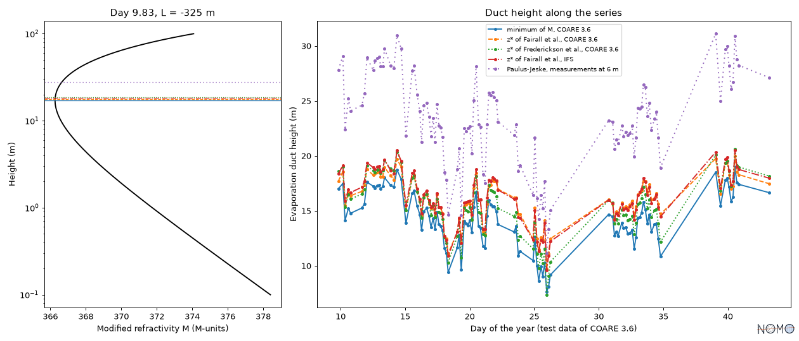

# The evaporation duct: from shipboard measurements to the duct height

Over the sea, the humidity falls quickly with height in the first metres,
and with it the radio refractivity N. A horizontal wave whose refraction
exceeds the curvature of the Earth is trapped, or ducted (Fairall et al.
1978, p. 11): below the height where the modified refractivity
M = N + 157 h (h in km, ITU-R P.453, equation 17) is at its minimum, the
evaporation duct. Its height is computed from routine measurements at
sea, through the surface layer, by several methods that disagree.

This page chains the formulations of the catalog from the measurements of
a ship to the height of the duct, with two algorithms of the surface
layer, COARE 3.6 and the IFS, and four ways to the height. Every step
names its entry of the catalog; the few that are not in it are said.

## The measurements

The test data of COARE 3.6 (NOAA-PSL/COARE-algorithm, MIT licence), one
row in 20 (`docs/examples/data/coare36_test.csv`, see its notice): 109
measurements between 13° N and 16° N, the wind at 18 m, the temperature and
the relative humidity at 17 m, the pressure, and the sea temperature, a
little more than 1 °C above the air's (median 1.1 °C). All are unstable:
the Obukhov length COARE gives runs from -326 m to -4.5 m, for winds of
2.3 to 12.4 m/s.

The skin temperature and the humidity at the sea surface are the ones
COARE computes, with its warm layer and its cool skin, which the catalog
does not hold.

## The surface layer, by a fixed point

The scales u\*, θ\* and q\* and the Obukhov length L depend on each other:
both algorithms iterate. Each step is a formulation of the catalog,
called by its key:

| Step | COARE 3.6 | IFS (CY49R1, Part IV) |
|---|---|---|
| Charnock coefficient, roughness for momentum | `coare36_charnock_coefficient`, `edson2013_roughness_length_momentum` | `ecmwf_ifs_roughness_length_momentum_sea` |
| Roughness for heat and humidity | `coare36_roughness_length_heat`, `coare36_roughness_length_humidity` | `ecmwf_ifs_roughness_length_heat_sea`, `ecmwf_ifs_roughness_length_humidity_sea` |
| Stability | `coare36_obukhov_length`, from the scales | `ecmwf_ifs_bulk_richardson_number` (3.26), then `ecmwf_ifs_obukhov_length_from_bulk_richardson_number` (3.25) |
| Scales | `coare36_friction_velocity`, `coare36_temperature_scale`, `coare36_humidity_scale` | `ecmwf_ifs_transfer_coefficient_momentum`, `_heat`, `_humidity` (3.16 to 3.18), `ecmwf_ifs_friction_velocity` |

Not in the catalog, and written in the script: the convective gust of
COARE, 1.2 w\* from the buoyancy flux (Fairall et al. 1996), and the
kinematic viscosity of air as COARE writes it (Andreas 1989). The IFS
has a gust too (equations 3.19 and 3.20), not yet in the catalog: its
variant goes without. The gravity is the normal gravity of WGS 84 at the
latitude (`wmo_normal_gravity_wgs84`).

Two steps show how the catalog keeps a formula within its bounds:

- below a 10 m neutral wind of 2.94 m/s, the line of Edson et al. (2013)
  gives a negative Charnock coefficient, beyond the bounds of its kind,
  which nomogram gives as NaN unless asked; COARE takes it, its smooth
  flow term keeping the roughness length positive, and so does the script,
  with `outside="ignore"`, for one measurement;
- equation 3.25 of the IFS is an implicit equation in L, solved at each
  iteration; its root has the sign of Ri_b, and the script narrows the
  search to that side with `search=`, away from the pole at L = 0, where
  the residual is no longer computed meaningfully.

```python
m = measurements()
a = air(m)
by_coare, by_ifs = coare(m, a), ifs(m, a)
z_star = duct_heights(a, by_coare)
length[side] = value(
    "ecmwf_ifs_obukhov_length_from_bulk_richardson_number",
    "m",
    Ri_b=Q_(richardson[side], ONE),
    z_n=z_n[side],
    z_0M=z_0["z_0M"][side],
    z_0H=z_0["z_0H"][side],
    search=search,
)
```

The fixed point over the catalog gives back the outputs of COARE: the
median deviations are 0.02 % on u\*, 0.05 % on the roughness length,
0.6 % on L, 0.8 % on q\* and 0.9 % on θ\* (0.003 K at most). They come
from what the script takes otherwise: the humidity at 17 m, the gravity,
and the skin temperature fixed at its final value.

On the same measurements, the IFS departs from COARE: its roughness
length is twice COARE's (a Charnock coefficient of 0.018, where the line
of Edson et al. gives about 0.011 at 10 m/s), u\* +5 %, L +18 % (less
unstable), θ\* -6 % and q\* -3 %, in medians.

## From the profiles to the duct

The profiles of temperature and humidity of COARE carry the measurements
from 17 m to any height (`coare36_temperature_at_height`,
`coare36_specific_humidity_at_height`), the pressure follows the
hypsometric equation (`wmo_hypsometric_pressure`), the vapour pressure its
definition (`wmo_vapour_pressure_definition`), and P.453 gives N
(`itu_r_p453_refractivity_total_pressure`) and M
(`itu_r_p453_modified_refractivity`), from 0.1 m to 100 m:

```python
profiles = modified_refractivity(m, a, by_coare)
return value(
    "itu_r_p453_modified_refractivity",
    "ppm",
    N=Q_(n, "ppm"),
    h=Q_(HEIGHTS[None, :], "m"),
)
```

The height of the minimum of M runs from 7.7 m to 19.0 m.

## Four ways to the duct height

| Way | Source, in the catalog | What it assumes |
|---|---|---|
| Minimum of M | the profiles of COARE 3.6, P.453 | κ = 0.4 and the stability functions of COARE; 157 = 10⁶/a, an Earth of radius about 6370 km |
| z\* of Fairall et al. (1978), equation 25 | `fairall1978_evaporation_duct_height` | κ = 0.35, α_T = 1.35, φ_T of their appendix B; 0.125 = 0.157 - 0.032 m⁻¹, the critical gradient (the same 157) and the hydrostatic term near sea level |
| z\* of Frederickson et al. (1994), equation 3 | `frederickson1994_evaporation_duct_height` | k = 0.4, no α_T, φ_s; the same 0.125; q\* in g/kg |
| Paulus-Jeske (NOSC TD 1596) | the `paulus1989_*` steps | its bulk Richardson number (wind in knots), profile coefficient and potential refractivity; the measurements at its reference height, 6 m |

Fairall et al. and Frederickson et al. take the scales: those of COARE,
the scale of mixing ratio of Fairall et al. derived from that of specific
humidity (dr = dq/(1 - q)²); and those of the IFS for Fairall et al.
Paulus-Jeske takes the measurements, at 17 and 18 m here, as if at 6 m.
Against the minimum of M, in medians over the 109 measurements:

| Way | Deviation from the minimum of M |
|---|---|
| z\* of Fairall et al., scales of COARE | +11 % |
| z\* of Frederickson et al., scales of COARE | +9 % |
| z\* of Fairall et al., scales of the IFS | +13 % |
| Paulus-Jeske | +65 % (+46 % to +74 %) |

The scales of the two algorithms change the height of Fairall et al. by
about 1 %, less than the ways differ from one another.



The script that computes these values and draws the figure is
[`docs/examples/evaporation_duct.py`](examples/evaporation_duct.py); a
test checks that the code shown here is its own and that this page gives
the values it computes.

## What the chain shows

The catalog holds the alternatives side by side (two algorithms of the
surface layer, four ways to the height), each with its source, its
assumptions and its bounds; a formula appears once, in its own entry,
whatever the chain that calls it; a value beyond the bounds of its kind
is NaN unless asked, which keeps a chain from going on silently.
