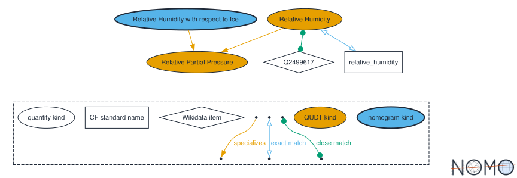

# Graphs of kinds and systems

`nomogram.graph` writes two views of the catalog as graphs, to exchange
and draw them: the tree of quantity kinds, with their matches in shared
vocabularies, and the equations of a system with their variables. Each is
a node-link document of NetworkX: a plain `dict`, written as JSON in one
line of Python, read by NetworkX with
`networkx.node_link_graph(document, edges="edges")`, and drawn by
[protee](https://github.com/miki4iaml/protee), whose conventions it
follows (see [The format](#the-format)). nomogram needs neither to write
it.

## The tree of kinds

`kind_graph` takes kinds by name, by reference or as a search finds them,
and adds the kinds they specialize, as far as the catalog holds them:

```python
import json
from pathlib import Path

from nomogram.catalog import catalog
from nomogram.graph import kind_graph, system_graph

c = catalog()
humidity = kind_graph(c.search("humid*", section="kinds"))
branch = kind_graph(["RelativeHumidity", "RelativeHumidityWithRespectToIce"])
text = json.dumps(branch, ensure_ascii=False, indent=2)
```

A kind is a node whose `id` is its reference in the catalog, of type
`qudt:QuantityKind`, with its `origin`: `qudt`, `nomogram` (a kind QUDT
lacks, declared as a specialization of a QUDT kind) or `provisional` (a
kind awaiting a pull request to QUDT, given by `pending`). An edge
`qudt:specializationOf` goes from a kind to the kind it specializes. Each
match in an external vocabulary is a node whose `id` is the IRI of the
entity, a CF standard name or a Wikidata item, linked by its SKOS
relation and the date of its last verification. The branch of relative
humidity:

```json
"nodes": [
  {"id": "kinds.RelativeHumidity", "label": "Relative Humidity", "type": "qudt:QuantityKind",
   "origin": "qudt", "iri": "http://qudt.org/vocab/quantitykind/RelativeHumidity"},
  {"id": "kinds.RelativePartialPressure", "label": "Relative Partial Pressure",
   "type": "qudt:QuantityKind", "origin": "qudt",
   "iri": "http://qudt.org/vocab/quantitykind/RelativePartialPressure"},
  {"id": "kinds.RelativeHumidityWithRespectToIce", "label": "Relative Humidity with respect to Ice",
   "type": "qudt:QuantityKind", "origin": "nomogram", "family": "moist-air"},
  {"id": "http://www.wikidata.org/entity/Q2499617", "label": "Q2499617",
   "type": "wikibase:Item", "iri": "http://www.wikidata.org/entity/Q2499617"},
  {"id": "http://vocab.nerc.ac.uk/standard_name/relative_humidity/", "label": "relative_humidity",
   "type": "nomogram:cfStandardName",
   "iri": "http://vocab.nerc.ac.uk/standard_name/relative_humidity/"}
],
"edges": [
  {"source": "kinds.RelativeHumidity", "target": "kinds.RelativePartialPressure", "key": 0,
   "type": "qudt:specializationOf"},
  {"source": "kinds.RelativeHumidity", "target": "http://www.wikidata.org/entity/Q2499617",
   "key": 0, "type": "skos:closeMatch", "verified": "2026-11-25"},
  {"source": "kinds.RelativeHumidity",
   "target": "http://vocab.nerc.ac.uk/standard_name/relative_humidity/",
   "key": 0, "type": "skos:exactMatch", "verified": "2026-11-25"},
  {"source": "kinds.RelativeHumidityWithRespectToIce", "target": "kinds.RelativePartialPressure",
   "key": 0, "type": "qudt:specializationOf"}
]
```

The tree stops where the subset of QUDT that nomogram bundles stops: the
parent of `RelativePartialPressure` in QUDT is not in it.

Drawn by protee, with the styles of a script of the documentation
([`graph_figures.py`](examples/graph_figures.py)), the same branch:

<picture>
  <source media="(prefers-color-scheme: dark)" srcset="images/kinds-relative-humidity-dark.svg">
  
</picture>

## A system

`system_graph` takes a system of the catalog, or one built by hand
(`nomogram.systems.System`):

```python
coare = system_graph("coare36_surface_layer")
Path("coare36.json").write_text(json.dumps(coare, ensure_ascii=False), encoding="utf-8")
```

The equations come first, in the order the source computes them: their
`id` is `equations.` and the variable they give, with the label and the
reference of the formulation, and their `rank` in that order. The
variables follow, `variables.` and their name, each with its `role`:

| Role | The variable |
|---|---|
| `nomogram:input` | no equation gives it |
| `nomogram:unknown` | an equation reads it before the equation that gives it: what the source iterates on |
| `nomogram:intermediate` | an equation gives it, and it is read only after |

An edge `nomogram:reads` goes from a variable to each equation that takes
it, an edge `nomogram:gives` from an equation to its variable. A read by
an equation that comes before the equation giving the variable, or is
that equation, has the role `nomogram:closing`: it closes a loop, and the
source iterates on it. The cycles of the graph are the loops of the
source: for the loop of
[COARE 3.6](coare-system.md), NetworkX finds one strongly connected
component of 26 nodes, which holds the thirteen equations. The page on
that loop draws it, each equation merged with the variable it gives
([The system](coare-system.md#the-system)).

## The format

The conventions are those of `protee-node-link/0` (`nomogram.graph.FORMAT`),
agreed with protee:

- `graph` names the format, the producer (nomogram and its version), the
  language of the labels (`en`), the prefixes used, and the values each
  attribute takes (`vocabulary`: `type`, `origin`, `role`, the last for
  variables and reads), each with its
  label, its description and, for an edge, whether it is symmetric; a
  system's graph also has its `label`, its `description` (the note of the
  system) and its `reference`;
- a node `id` is opaque and stable from one version of nomogram to the
  next, never expanded, even as an IRI;
- types are prefixed by the vocabulary that defines their meaning
  (`qudt:`, `skos:`, `wikibase:`), and by `nomogram:` for what exists in
  nomogram alone; nomogram has no published namespace yet, so its prefix
  maps to `null`;
- the order of the nodes and edges is stable; the edges are grouped by
  source, in the order of the nodes, then by target, as NetworkX lists
  them, so that a document read and written again by NetworkX comes back
  unchanged;
- other keys are allowed, and a consumer keeps them: `verified` on a
  match, `rank` and `formulation` on an equation, `kind`, `unit` and
  `unit_symbol` on a variable.

A key added to the format, if optional, keeps its version; a key removed,
renamed or changed in meaning changes it.

## Through the search

A graph is computed on demand, never stored: it is not an entry of the
catalog, and adds nothing to the index. `kind_graph` takes the entries a
search finds (`c.search("humid*", section="kinds")`), and `system_graph`
the system entry (`c.search("coare", section="systems")[0]`).
