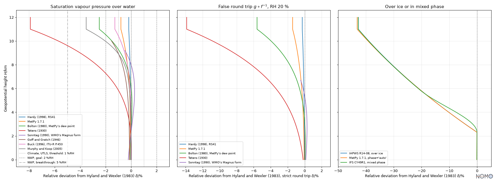

# Humidity aloft: the formula of the producer and that of the user

Air humidity has several representations: with the temperature, the
relative humidity (over water or over ice), the dew or frost point, the
vapour pressure, the absolute humidity, the wet-bulb temperature; with
the pressure as well, the specific humidity, the mixing ratio, the mole
fraction. Several formulations, and sets of formulations, convert one
into another, and they disagree: as the air cools aloft, a conversion,
and more so a chain of them, can bias the data by as much as their
uncertainty, or more. Such a bias can be corrected only when the data
name the formulations that made them.

The lineage of an observation, a computation or a model output should
therefore cite its formulas, as it cites its instruments; without that,
the uncertainty paid for in a sensor, a measuring chain or a model can be
lost at the first post-processing.

The report of the 2022 upper-air instrument intercomparison of the World
Meteorological Organization (WMO), held at Lindenberg in August and
September 2022 (IOM No. 143, 2024), gives the occasion to measure these
gaps. It names the vapour pressure equation of each radiosonde, finds
that the dew point and the relative humidity of the same sounding
disagree aloft, and recalls that converting between them requires the
vapour pressure equation and its inverse (section 10.1.4). This page
computes, with nomogram, the gaps these formulations produce along a
vertical profile, through the dew point, over water or over ice, and
sets them against WMO's requirements.

## The formulas of WMO

WMO gives its formulations in its guide (WMO-No. 8, 2024, Volume I). Its
Technical Regulations refer to the guides for formulas (WMO-No. 49,
Volume I, general provisions, 5), and so does, through them, the rule of
the dew point in BUFR messages (below). Annex 4.B of the guide gives
Magnus forms, convenient but not suitable below -45 °C over water. For
radiosondes, at the lowest temperatures, the guide asks manufacturers to
use Wexler (1976, 1977), Hyland and Wexler (1983) or Sonntag (1994), and
not the Goff-Gratch equation recommended in earlier WMO publications
(12.4.1):

| In WMO-No. 8 | Formulation | Range stated | In the catalog |
|---|---|---|---|
| Annex 4.B | Magnus form, coefficients of Sonntag (1990), over water | -45 to 60 °C | `sonntag1990_magnus` |
| Annex 4.B | Magnus form over ice | -65 to 0 °C | `wmo2008_ice` |
| 12.4.1, radiosondes | Wexler (1976, 1977) | 0 to 100 °C over water, in the title of 1976; Hardy (1998) refits it to ITS-90 from -100 to 100 °C | `hardy1998_water` |
| 12.4.1, radiosondes | Hyland and Wexler (1983) | 173.15 to 473.15 K, in the title | `hyland_wexler1983` |
| 12.4.1, radiosondes | Sonntag (1994) | not read | `sonntag1990`, the same coefficients after Vömel |
| 12.4.1, set aside | Goff and Gratch (1946) | -50 to 102 °C (Gibbins 1990) | `goff_gratch1946` |

Wexler's formulation over water is thus extrapolated below 0 °C, as Hardy
notes; the ranges of Hyland and Wexler, and of Sonntag, are those of the
titles or of secondary sources, the originals not read.

## The formula of each radiosonde

The report names, in its Table 3.3, the vapour pressure equation of
each radiosonde, as its manufacturer states it:

| Radiosonde | Vapour pressure equation | In the catalog |
|---|---|---|
| RS41 (Vaisala), iMet-54 | Wexler, modified by Hardy (1998) for ITS-90 | `hardy1998_water` |
| CF-06-AH, DFM-17, iMS-100 | Hyland and Wexler (1983) | `hyland_wexler1983` |
| GTH3 | Goff and Gratch (1946) | `goff_gratch1946` |
| M20 | Sonntag (1990) | `sonntag1990` |
| PS-B3 | Bolton (1980) | `bolton1980` |
| WxR-301D | Buck (1981), the variant not stated | `buck1981` |

The report names these formulas and does not print them: the catalog
records it in their notes, with the keyword `radiosonde`. Vaisala also
publishes simplified conversion formulas (`vaisala2013_water`,
`vaisala2013_ice`), fitted to Wagner and Pruss within 0.083 % from -20 to
50 °C and to its equation over ice within 0.052 %: both fits are
relations nomogram verifies, and reproduces. That note is general, and
its simplified form over water stops at -20 °C; the RS41 computes with
Hardy (1998), whose formulation over water covers -100 to 100 °C.

## Two definitions of the relative humidity

WMO relates the relative humidity to the saturation of moist air, larger
than that of pure water by the enhancement factor, about 0.5 % near
1000 hPa, and so does ITU-R P.453 (`itu_r_p453_es_water`, Buck 1996 times
the enhancement factor). Vaisala relates it to the saturation vapour
pressure of pure water, below 0 °C to that of supercooled water. The
catalog keeps the two apart, as
`SaturationVapourPressureOverWater` and
`SaturationVapourPressureOverWaterInMoistAir`: `compare` puts them in one
table only when asked for a kind they share, `kind="VapourPressure"`. The
difference does not show in the formulas; recomputing an
absolute humidity with P.453 from a relative humidity of Vaisala gives
it 0.2 to 0.4 % larger between the ground and 5 km.

## Along a vertical profile

The figure follows the reference atmosphere of ITU-R P.835, identical to
the ISO 2533 standard atmosphere up to 32 km, from the ground to 12 km:
above 11 km, its temperature stays at -56.5 °C up to 20 km, and the gaps
stop growing; where the tropopause is colder, they keep growing: it
reached -60 °C during the intercomparison, and is near -85 °C in the
tropics (IOM No. 143, sections 2.2 and 9.2). On the left, each
formulation a user may take, against Hyland and Wexler (1983), which WMO
names for radiosondes. In the middle, the false round trip: the producer
codes a dew point with the inverse of its formulation, as BUFR messages
require, and the user takes the vapour pressure back with another
formulation, at a relative humidity of 50 %. On the right, the
saturation over ice, or in mixed phase, against the same reference (see
[Over water or over ice](#over-water-or-over-ice)).

```python
import numpy as np

import nomogram as nomo
from nomogram.catalog import catalog
from nomogram.comparison import Composition, Evaluable, compare, compose
from nomogram.inversion import invert
from nomogram.model import Variable
from nomogram.units import Q_

import matplotlib.pyplot as plt

f = catalog().formulations
air = f["itu_r_p835_temperature"]  # the ISO standard atmosphere up to 32 km


def along(key: str, label: str, temperature: Evaluable = air) -> Composition:
    formulation = f[key]
    point = formulation.inputs[0].identifier
    return compose(formulation, {point: temperature}, label=label)


wmo = "hyland_wexler1983"  # named by WMO for radiosondes (WMO-No. 8, 12.4.1)
users = {
    "hardy1998_water": "Hardy (1998), RS41",
    "metpy171_saturation_vapour_pressure": "MetPy 1.7.1",
    "bolton1980": "Bolton (1980), MetPy's dew point",
    "tetens1930": "Tetens (1930)",
    "sonntag1990_magnus": "Sonntag (1990), WMO's Magnus form",
    "goff_gratch1946": "Goff and Gratch (1946)",
    "buck1996": "Buck (1996), ITU-R P.453",
    "murphy_koop2005_water": "Murphy and Koop (2005)",
}
grid = {"GeopotentialHeight": Q_(np.linspace(0, 12, 121), "km")}
reference = along(wmo, "Hyland and Wexler (1983)")
saturation = compare(
    [reference, *(along(k, label) for k, label in users.items())], reference, grid
)
inverse = invert(  # the dew point, solved numerically over the stated range
    f[wmo],
    "T",
    output=Variable("T_d", "DewPointTemperature", "K", "Dew point temperature"),
    input=Variable("e", "VapourPressure", "PA", "Vapour pressure"),
)
vapour = compose(f["vapour_pressure_from_relative_humidity"], {"e_s": reference})
dew_point = compose(inverse, {"e": vapour})
names = ("hardy1998_water", "metpy171_saturation_vapour_pressure", "bolton1980")
decoders = {k: users[k] for k in (*names, "tetens1930", "sonntag1990_magnus")}
back = along(wmo, "Hyland and Wexler (1983), strict round trip", dew_point)
decoded = compare(
    [back, *(along(k, label, dew_point) for k, label in decoders.items())],
    back,
    {**grid, "RelativeHumidity": Q_(0.5, "")},
)
phases = {
    "iapws_r14_08_sublimation": "IAPWS R14-08, over ice",
    "metpy171_saturation_vapour_pressure_auto": "MetPy 1.7.1, phase='auto'",
    "ecmwf_ifs_saturation_mixed_phase": "IFS CY49R1, mixed phase",
}
junctions = compare(
    [reference, *(along(k, label) for k, label in phases.items())],
    reference,
    grid,
    kind="SaturationVapourPressure",
)
oscar = {  # WMO OSCAR, at RH = 100 % (IOM No. 143, Table 9.2)
    "Climate, UTLS, threshold: 1 %RH": (-1, 1),
    "NWP, goal: 2 %RH": (-2, 2),
    "NWP, breakthrough: 5 %RH": (-5, 5),
}
documentation = nomo.display.DisplayOptions.DOCUMENTATION
figure, (left, middle, right) = plt.subplots(1, 3, sharey=True)
nomo.plot.plot_deviation_profile(
    saturation, references=oscar, ax=left, options=documentation, xlim=(-9, 3)
)
nomo.plot.plot_deviation_profile(
    decoded, ax=middle, options=documentation, xlim=(-15, 3)
)
nomo.plot.plot_deviation_profile(
    junctions, ax=right, options=documentation, xlim=(-50, 5)
)
```



Each curve stops where its source stops answering: the Magnus form of
WMO at -45 °C, Goff and Gratch at -50 °C; the saturation over ice of
IAPWS starts at the triple point, near 2.3 km.

We choose Hyland and Wexler (1983) as the reference, one of the
formulations WMO recommends for radiosondes (see
[The formulas of WMO](#the-formulas-of-wmo)). A user may assume that a
producer follows WMO: the RS41 does, with Hardy (1998), Wexler's
formulation refitted to ITS-90 (IOM No. 143, Table 3.3), 0.18 % from the
reference at 11 km.

At 11 km, where the temperature reaches -56.5 °C, the saturation vapour
pressure of each formulation (left panel):

| Formulation | Saturation vapour pressure | Deviation from Hyland and Wexler (1983) |
|---|---|---|
| Hyland and Wexler (1983), WMO | 3.006 Pa | reference |
| Hardy (1998), RS41 | 3.001 Pa | -0.18 % |
| MetPy 1.7.1 | 2.982 Pa | -0.80 % |
| Bolton (1980), MetPy's dew point | 2.931 Pa | -2.50 % |
| Tetens (1930) | 2.769 Pa | -7.90 % |
| Buck (1996), ITU-R P.453 | 2.968 Pa | -1.27 % |
| Murphy and Koop (2005) | 2.900 Pa | -3.52 % |

BUFR messages carry the dew point, not the relative humidity: WMO
imposes it (IOM No. 143, section 10.1.4). Its rule names the formulation
only by reference: the dew point "shall be derived using the function
(or a near equivalent)" of the Technical Regulations (WMO-No. 306,
Volume I.2, 2025, B/C25.7.2.7.1), which refer to the guide. But the
message does not say which formulation computed it: in practice, each
manufacturer codes it with its own (IOM No. 143, Table 3.3). To take back
a vapour pressure or a relative humidity, a user needs that formulation
and its inverse (section 10.1.4); the round trip follows that chain.

The round trip (middle panel) starts from what the radiosonde measures at
11 km: a temperature T of -56.5 °C and a relative humidity of 50 %,
within the range the intercomparison observed below the tropopause,
from about 5 to 100 %RH (IOM No. 143, Figure 9.2). The producer computes
the vapour pressure with its formulation f, here Hyland and Wexler's,
e = 0.50 f(T) = 1.503 Pa, and codes the dew point with its inverse,
which nomogram solves numerically: Td = f⁻¹(e) = -62.1 °C. The user
takes back the vapour pressure with a formulation g, e′ = g(Td), and the
relative humidity, g(Td)/g(T), as WMO's guide writes it from the dew
point (WMO-No. 8, 4.B.11). With g = f, the round trip is strict,
f ∘ f⁻¹, and gives back the start; with another g, it is false, g ∘ f⁻¹:

| Formulation g of the user | Vapour pressure e′ = g(Td) | Deviation from e | Relative humidity g(Td)/g(T) | Deviation |
|---|---|---|---|---|
| Hyland and Wexler (1983), strict round trip f ∘ f⁻¹ | 1.503 Pa | 0.00 % | 50.00 % | 0.00 %RH |
| Hardy (1998), RS41 | 1.500 Pa | -0.22 % | 49.98 % | -0.02 %RH |
| MetPy 1.7.1 | 1.488 Pa | -1.04 % | 49.88 % | -0.12 %RH |
| Bolton (1980), MetPy's dew point | 1.448 Pa | -3.66 % | 49.40 % | -0.60 %RH |
| Tetens (1930) | 1.349 Pa | -10.26 % | 48.72 % | -1.28 %RH |
| Sonntag (1990), WMO's Magnus form | outside its range, below -45 °C | | | |

A user who needs a vapour pressure, an absolute humidity or a mixing
ratio takes e′: the round trip widens the gap of the saturation 1.2 to
1.5 times, since it evaluates the two formulations at the dew point,
colder than the air, and more in drier air: with Tetens' form, -13.9 % at
a relative humidity of 20 %, -20.4 % at 5 %. A user who needs the
relative humidity divides by g(T): the two gaps partly cancel, and
-1.3 %RH remains with Tetens' form, between -1.1 and -1.4 %RH from 20 to
60 %; the gap vanishes at saturation, where the dew point is the
temperature.

The false round trip can also sit with the producer, when it codes the
dew point with an inverse that is not that of its own formulation,
f ∘ h⁻¹. The intercomparison saw such a gap between the BUFR messages and
the files of the same manufacturers: relative humidity and dew point
disagree negligibly near the surface, and by more than 10 % in the upper
troposphere, beyond typical measurement uncertainties, possibly through
the inverse of the vapour pressure equation; the report asks the
manufacturers concerned to review their calculations (IOM No. 143,
section 10.1.4).

## Over water or over ice

Below 0 °C, the same water vapour gives two relative humidities: over
supercooled water, and over ice. WMO recommends the first, and the
radiosondes report it, including below freezing (IOM No. 143, section
1.5); the report recalls that it is lower than the relative humidity
over ice for the same water vapour content (chapter 6). Other codes
take another saturation below 0 °C:

| Relative humidity | Saturation below 0 °C | In the catalog |
|---|---|---|
| WMO, radiosondes, Vaisala | over supercooled water | `hyland_wexler1983`, `hardy1998_water` |
| MetPy 1.7.1, with `phase='auto'` (over water by default) | over ice, from the triple point, 273.16 K | `metpy171_saturation_vapour_pressure_auto` |
| IFS CY49R1, diagnostic relative humidity | over ice below 250.16 K (-23 °C); from there to 0 °C, weighted by a liquid fraction quadratic in temperature | `ecmwf_ifs_saturation_mixed_phase` |

The catalog keeps the saturation over water and over ice as sibling
kinds, `SaturationVapourPressureOverWater` and
`SaturationVapourPressureOverIce`, both a `SaturationVapourPressure`:
`compare` puts them in one table only when asked for that kind,
`kind="SaturationVapourPressure"`, as on the right of the figure. MetPy
changes phase at the triple point, the IFS gradually from 0 to -23 °C.
At 11 km, the saturation over ice is 42.7 % below that over water: air
saturated over ice has a relative humidity of 57 % over water. Between
the relative humidity of a radiosonde and that of the IFS, the gap of
convention is there more than five times the largest gap of formulation
on the left of the figure, that of Tetens.

## Against the requirements of WMO

The OSCAR requirements the intercomparison uses (IOM No. 143, Table 9.2)
give the uncertainty of the relative humidity in percentage points
(%RH), at one standard deviation, bias and random error combined:

| Application | Threshold | Breakthrough | Goal |
|---|---|---|---|
| Numerical weather prediction, boundary layer and free troposphere | 10 %RH | 5 %RH | 2 %RH |
| Climate, boundary layer and free troposphere | 0.5 %RH | 0.25 %RH | 0.05 %RH |
| Climate, upper troposphere and lower stratosphere | 1.0 %RH | 0.5 %RH | 0.25 %RH |

A relative deviation becomes percentage points when multiplied by the
relative humidity: at saturation, as on the left of the figure, 1 % is
1 %RH. In the lower troposphere, the choice of formulation stays well
under the goal of numerical weather prediction. Aloft, Bolton's form
goes beyond that goal, and Tetens' beyond the breakthrough. For climate,
even the difference of definition, 0.2 to 0.4 %RH, takes most of the
threshold.
The gap is a bias, not a noise: it does not average out.

## Search

`search(keyword="radiosonde")` finds the formulations a radiosonde uses,
`search(keyword="mixed phase")` those that join water and ice,
`search("12.4.1")` those WMO names for radiosondes, `search("BUFR")`
the rule of the Manual on Codes for the dew point,
`search("RS41")` the intercomparison report, and
`used_by("references.vaisala2013")` what Vaisala's formulas give,
including its citation of Wagner and Pruss.
