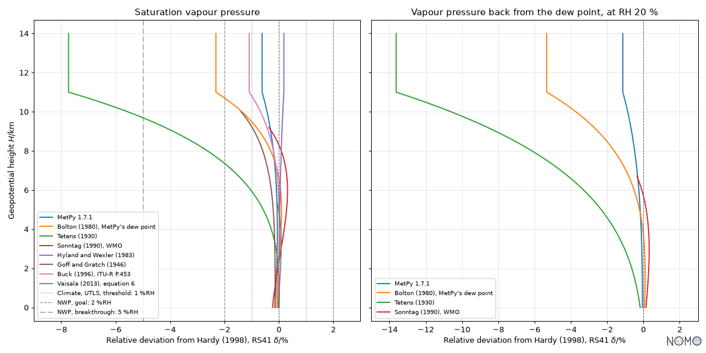

# Humidity aloft: the formula of the producer and that of the user

A radiosonde measures the relative humidity; its manufacturer computes
what it reports with one saturation vapour pressure formulation, and the
user often recomputes a dew point, a vapour pressure or an absolute
humidity with another. Near the ground the two agree; as the air cools
aloft, their gap grows, and it becomes a bias of the order of the
uncertainty of the sensors. This page shows the gap along a vertical
profile, then the false round trip through the dew point, and sets them
against the requirements of the World Meteorological Organization (WMO).

## The formula of each radiosonde

The report of WMO's 2022 upper-air instrument intercomparison (IOM No.
143, 2024, Table 3.3) names the vapour pressure equation of each
radiosonde, as its manufacturer states it:

| Radiosonde | Vapour pressure equation | In the catalog |
|---|---|---|
| RS41 (Vaisala), iMet-54 | Wexler, modified by Hardy (1998) for ITS-90 | `hardy1998_water` |
| CF-06-AH, DFM-17, iMS-100 | Hyland and Wexler (1983) | `hyland_wexler1983` |
| GTH3 | Goff and Gratch (1946) | `goff_gratch1946` |
| M20 | Sonntag (1990) | `sonntag1990` |
| PS-B3 | Bolton (1980) | `bolton1980` |
| WxR-301D | Buck (1981), the variant not stated | `buck1981` |

The report names these formulas and does not print them: the catalog
records it in their notes, with the keyword `radiosonde`. Vaisala also
publishes simplified conversion formulas (`vaisala2013_water`,
`vaisala2013_ice`), fitted to Wagner and Pruss within 0.083 % from -20 to
50 °C and to its equation over ice within 0.052 %: both fits are
relations nomogram verifies, and reproduces.

## Two definitions of the relative humidity

Vaisala relates the relative humidity to the saturation vapour pressure
of pure water, below 0 °C to that of supercooled water. WMO relates it to
the saturation of moist air, larger by the enhancement factor, about
0.5 % near 1000 hPa, and so does ITU-R P.453 (`itu_r_p453_es_water`, Buck
1996 times the enhancement factor). The catalog keeps the two apart, as
`SaturationVapourPressureOverWater` and
`SaturationVapourPressureOverWaterInMoistAir`: `compare` refuses to put
them in one table. The difference does not show in the formulas; recomputing an
absolute humidity with P.453 from a relative humidity of Vaisala
overestimates it by 0.2 to 0.4 % between the ground and 5 km.

## Along a vertical profile

The figure follows the reference atmosphere of ITU-R P.835, identical to
the ISO 2533 standard atmosphere up to 32 km, from the ground to 14 km.
On the left, each formulation a user may take, against the producer's,
Hardy (1998), that of the RS41. On the right, the false round trip: the
producer codes a dew point with its own inverse, as BUFR messages
require, and the user takes the vapour pressure back with another
formulation, at a relative humidity of 20 %.

```python
import numpy as np

import nomogram as nomo
from nomogram.catalog import catalog
from nomogram.comparison import Composition, Evaluable, compare, compose
from nomogram.units import Q_

import matplotlib.pyplot as plt

f = catalog().formulations
air = f["itu_r_p835_temperature"]  # the ISO standard atmosphere up to 32 km


def along(key: str, label: str, temperature: Evaluable = air) -> Composition:
    formulation = f[key]
    point = formulation.inputs[0].identifier
    return compose(formulation, {point: temperature}, label=label)


producer = "hardy1998_water"  # Wexler refitted to ITS-90, that of the RS41
users = {
    "metpy171_saturation_vapour_pressure": "MetPy 1.7.1",
    "bolton1980": "Bolton (1980), MetPy's dew point",
    "tetens1930": "Tetens (1930)",
    "sonntag1990_magnus": "Sonntag (1990), WMO",
    "hyland_wexler1983": "Hyland and Wexler (1983)",
    "goff_gratch1946": "Goff and Gratch (1946)",
    "buck1996": "Buck (1996), ITU-R P.453",
    "vaisala2013_water": "Vaisala (2013), equation 6",
}
grid = {"GeopotentialHeight": Q_(np.linspace(0, 14, 141), "km")}
reference = along(producer, "Hardy (1998), RS41")
saturation = compare(
    [reference, *(along(k, label) for k, label in users.items())], reference, grid
)
vapour = compose(f["vapour_pressure_from_relative_humidity"], {"e_s": reference})
dew_point = compose(f["hardy1998_dew_point"], {"e": vapour})
names = ("metpy171_saturation_vapour_pressure", "bolton1980", "tetens1930")
decoders = {k: users[k] for k in (*names, "sonntag1990_magnus")}
back = along(producer, "Hardy (1998), RS41", dew_point)
decoded = compare(
    [back, *(along(k, label, dew_point) for k, label in decoders.items())],
    back,
    {**grid, "RelativeHumidity": Q_(0.2, "")},
)
oscar = {  # WMO OSCAR, at RH = 100 % (IOM No. 143, Table 9.2)
    "Climate, UTLS, threshold: 1 %RH": (-1, 1),
    "NWP, goal: 2 %RH": (-2, 2),
    "NWP, breakthrough: 5 %RH": (-5, 5),
}
documentation = nomo.display.DisplayOptions.DOCUMENTATION
figure, (left, right) = plt.subplots(1, 2, sharey=True)
nomo.plot.plot_deviation_profile(
    saturation, references=oscar, ax=left, options=documentation, xlim=(-9, 3)
)
nomo.plot.plot_deviation_profile(
    decoded, ax=right, options=documentation, xlim=(-15, 3)
)
```



Each curve stops where its source stops answering: Vaisala's simplified
form at -20 °C, near 5.4 km, the Magnus form of WMO at -45 °C, Goff and
Gratch at -50 °C. At 11 km, where the temperature reaches -56.5 °C:

| Formulation | Saturation vapour pressure | Vapour pressure back from the dew point, RH 20 % |
|---|---|---|
| MetPy 1.7.1 | -0.62 % | -1.14 % |
| Bolton (1980), MetPy's dew point | -2.32 % | -5.33 % |
| Tetens (1930) | -7.73 % | -13.63 % |
| Buck (1996), ITU-R P.453 | -1.09 % | |
| Hyland and Wexler (1983) | +0.18 % | |

The round trip widens the gap 1.8 to 2.3 times: it evaluates the two
formulations at the dew point, -68.9 °C there, colder than the air. The intercomparison saw
the same in practice: between the BUFR messages and the files of the
manufacturers, relative humidity and dew point disagree negligibly near
the surface, and by more than 10 % in the upper troposphere, beyond
typical measurement uncertainties, possibly through the inverse of the
vapour pressure equation (IOM No. 143, section 10.1.4).

## Against the requirements of WMO

The OSCAR requirements the intercomparison uses (IOM No. 143, Table 9.2)
give the uncertainty of the relative humidity in percentage points
(%RH), at one standard deviation, bias and random error combined:

| Application | Threshold | Breakthrough | Goal |
|---|---|---|---|
| Numerical weather prediction, boundary layer and free troposphere | 10 %RH | 5 %RH | 2 %RH |
| Climate, boundary layer and free troposphere | 0.5 %RH | 0.25 %RH | 0.05 %RH |
| Climate, upper troposphere and lower stratosphere | 1.0 %RH | 0.5 %RH | 0.25 %RH |

A relative deviation becomes percentage points when multiplied by the
relative humidity: at saturation, as on the left of the figure, 1 % is
1 %RH. In the lower troposphere, the choice of formulation stays well
under the goal of numerical weather prediction. Aloft, Bolton's form
reaches that goal and Tetens' goes beyond the breakthrough. For climate, even the
difference of definition, 0.2 to 0.4 %RH, takes most of the threshold.
The gap is a bias, not a noise: it does not average out.

## Search

`search(keyword="radiosonde")` finds the formulations a radiosonde uses,
`search("RS41")` the intercomparison report, and
`used_by("references.vaisala2013")` what Vaisala's formulas give,
including its citation of Wagner and Pruss.
