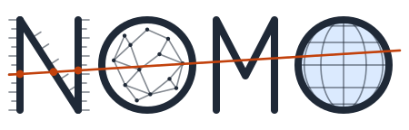

# The logo



The logo spells NOMO, the short name of the project: `import nomogram as
nomo`. *Nomos*, law or convention, is the root of the word nomogram.
Like the rest of the project, the logo is code:
[`scripts/make_logo.py`](../scripts/make_logo.py) computes every point
of it, with the standard library only.

## What it shows

- **N is a working nomogram.** An alignment chart of the N (or Z) type:
  two parallel scales, u read downward on the left stroke and v upward
  on the right one, joined by a diagonal scale for w = u / v.
- **A straight reading line** passes through u = 3 and v = 2.2. It
  crosses the diagonal at w = 3 / 2.2 ≈ 1.36, as reading a nomogram
  does, then runs on through the other letters.
- **The first O is a sphere of linked nodes**: the shared vocabularies
  that give each variable its meaning (QUDT, CF, Wikidata).
- **M is plain**, so that the N stays in front.
- **The second O is a globe**: the Earth sciences, where the formulas
  of the catalog are used.

## How it is computed

On the N, a value u lies at a·u below the top of the left stroke, and a
value v at a·v above the bottom of the right one. The line through both
meets the diagonal, which joins the top of the left stroke to the
bottom of the right one, at the fraction s = a·u / (a·u + a·v) of its
length, that is s = w / (1 + w). The diagonal is graduated there
(w = 0.25, 0.5, 1, 2, 4), and the script checks that the reading line
crosses it at u / v before writing a file.

The first O takes points of a Fibonacci lattice on the visible side of a
sphere, each linked to its nearest neighbours. The globe is an
orthographic projection seen from the equator. The meridians at ±30° and
±60° are ellipses whose half-width is R sin λ, and the parallels are
segments at height R sin φ.

## Colours

| Role | Light | Dark |
|---|---|---|
| Ink (letters, graduations, nodes) | `#1f2937` | `#e5e7eb` |
| Sea of the globe | `#dbeafe` | `#1e3a5f` |
| Reading line | `#c2410c` | `#fb923c` |

## Files

All in [`docs/images`](images/):

- `logo.svg`: the logo, which follows the light or dark preference of
  the viewer (a CSS media query);
- `banner-light.svg` and `banner-dark.svg`: the logo above the word
  "nomogram", drawn with strokes like the letters, in fixed colours. The
  README chooses between them with a `<picture>` element, which follows
  the GitHub theme; PyPI keeps the light one.
- `logo-icon.svg`: the N alone, with its graduations;
- `logo-favicon.svg`: the N alone at small sizes, thicker and without
  graduations.

These files are generated, never edited by hand. After changing the
script, run it again:

```
uv run python scripts/make_logo.py
```

A test checks that the files match what the script draws.
