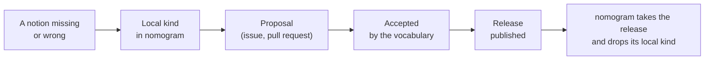
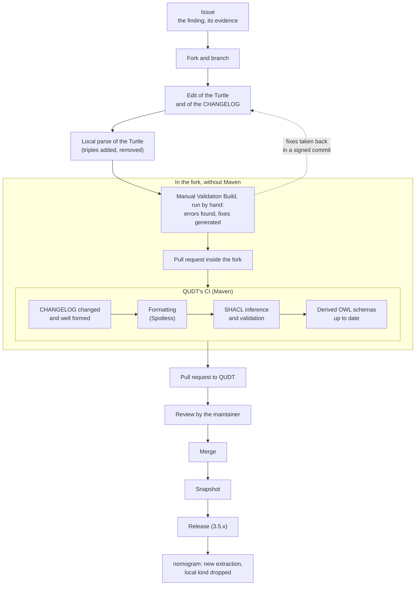

# Shared vocabularies: QUDT, CF and Wikidata

How nomogram builds on reference vocabularies, how it contributes to
them in return, and, technically, how a contribution to QUDT goes from
a finding to a release.

## a) The concept: building on them, contributing to them

### Why shared vocabularies

Between two technical fields, or two trades, the same terms do not
always mean exactly the same thing. To a meteorologist, "absolute
humidity" is a mass of water vapour per volume of air, in g/m³; to a
heating engineer, it is often a mass of water vapour per mass of dry
air, in g/kg. These are two different quantities, and taking one for
the other puts into a calculation an error that nothing signals.

Between two programs, the question is one of **interoperability**, on
two levels:
- **machine-readable** data: a format a program can decode, such as a
  CSV table or a NetCDF file;
- **machine-actionable** data, whose meaning the program understands:
  it knows that a column is an absolute humidity in g/m³, that a dew
  point is a temperature, and refuses to mix two quantities.

The second level needs a **shared vocabulary**, or **ontology**: a
public dictionary, written to be read by machines as much as by
people. For each notion, it gives:
- a unique and stable name, which is a web address;
- a definition;
- its links to other notions: "is a kind of", "is expressed in such a
  unit"...

nomogram builds on three of these vocabularies:

| Vocabulary | What it describes | Maintained by |
|---|---|---|
| **QUDT** | Quantity kinds and their units | QUDT.org, under CC BY 4.0 |
| **CF** | The standard names of variables in climate and weather data | The CF conventions, CC0 |
| **Wikidata** | Universal identifiers, in every language | The Wikimedia community |

The names of QUDT are web addresses. Opened in a browser,
<https://qudt.org/vocab/quantitykind/Density> shows a page; requested by
a program, the same address returns the same notion in a format it can
read (Turtle, see part b).

### What nomogram takes from them

- **The meaning of each variable.** Every input and output of a formula
  declares its quantity kind after QUDT: thermodynamic temperature,
  vapour pressure, specific humidity... The catalog then refuses to use
  a relative humidity with respect to ice as the input of a formula that
  expects one with respect to water.
- **The units.** QUDT gives, for each kind, the units that suit it.
  nomogram maps them to the units of pint, the units library it uses,
  and declares that mapping.
- **The links to data.** The CF standard name of a kind
  (`air_temperature`, `specific_humidity`...) links a formula to the data
  files that carry that name.
- **Every language.** A Wikidata link finds the same notion in every
  language.

As of 1 November 2026, the 79 kinds the catalog uses are all QUDT kinds,
or specializations of one; 29 have a CF standard name, 35 a Wikidata
link.

### What nomogram gives back

These vocabularies are not exhaustive, and they may hold errors. Rather
than each project working on its own with local additions, nomogram
proposes the corrections at the source:



Some examples:
- **Missing notions**: the geopotential, the geopotential height, the
  pressure altitude, the lapse rate, the specific latent heat. All
  entered QUDT at nomogram's request; the density of dry air and of
  moist air is under review (qudt/qudt-public-repo#1600).
- **Errors**: in QUDT, the per mille pointed to the Wikidata item of the
  percent; in Wikidata, the pressure altitude and the QNH were both
  labelled "QNE" in French; in the CF table, a typo mars the definition
  of the sea water temperature.

As of 3 November 2026: 9 pull requests proposed to QUDT, all accepted (8
on the day they were opened), a tenth under review; 21 edits to
Wikidata; one typo reported to CF.

### Safeguards

- **No redefinition.** When QUDT has the kind, nomogram uses it.
- **No confusion.** Two quantities that look alike stay two sibling
  kinds (relative humidity with respect to water and to ice, density of
  dry and of moist air), even when they share a unit and a dimension.
- **Checked at the source.** A vocabulary may hold errors: the source is
  read, the error reported, and the catalog says what it corrects
  locally until the official correction.
- **Qualified links.** A link to Wikidata or CF says whether it points to
  exactly the same notion, a close one, a broader or a narrower one, and
  when it was last checked.

## b) Technically: the contribution chain to QUDT

### The format: Turtle

QUDT is written in **Turtle**, a text format of RDF, which describes
every piece of information as **triples**, *subject - predicate -
object*. An abridged excerpt of the proposal under review:

```turtle
quantitykind:DensityOfDryAir
  a qudt:QuantityKind ;
  qudt:hasDimensionVector qkdv:A0E0L-3I0M1H0T0D0 ;
  qudt:isoNormativeReference "https://www.iso.org/standard/7472.html"^^xsd:anyURI ;
  qudt:specializationOf quantitykind:Density ;
  rdfs:label "Density of Dry Air"@en ;
  rdfs:seeAlso quantitykind:DensityOfMoistAir .
```

Each line is a triple whose subject is `DensityOfDryAir`: it is a
quantity kind, of dimension M L⁻³, has ISO 2533 as its normative
reference, specializes `Density`, carries a label and points to its
sibling `DensityOfMoistAir`.

### The QUDT repository

The work happens on GitHub, in the repository `qudt/qudt-public-repo`:
- `src/main/rdf/vocab/`: the vocabularies (quantity kinds, units,
  constants...), one large Turtle file per vocabulary;
- `src/main/rdf/validation/`: the **SHACL rules**, which state what
  well-formed data must satisfy;
- `CHANGELOG.md`: each change of the sources is described there, under
  "Unreleased".

### The chain, from a finding to a release



1. **The issue** describes the finding as it stands in QUDT, with its
   evidence, one item per line, each verifiable (a standard, CF,
   Wikidata...).
2. **The fork and the branch**: the contributor works on their own copy
   of the repository.
3. **The edit** adds the triples at their alphabetical place, without
   touching the rest, and describes the change in the CHANGELOG.
4. **The local parse** of the Turtle by a parser (rdflib, in Python)
   checks the syntax and lists exactly the triples added and removed.
5. **The manual pre-test**: QUDT's "Manual Validation Build", run by
   hand from the Actions tab of the fork, builds the branch, shows the
   errors found and generates the fixes it knows how to make, published
   for review and pushed to the branch. It finds what is missing before
   the pull request: a new unit, for instance, needs labels in about ten
   languages, which this pass produces (the lesson of nomogram's
   qudt/qudt-public-repo#1597). Its additions are then taken back in a
   signed commit.
6. **QUDT's CI** runs in the fork through a pull request inside it,
   closed afterwards without being merged. With the pre-test, neither
   Java nor Maven is needed on one's computer, as the QUDT wiki
   provides. The CI:
   - refuses a change of the sources without an entry in the CHANGELOG,
     or an ill-formed entry;
   - checks the formatting of the files (Spotless);
   - **infers** the triples that are never written by hand (the units
     applicable to a kind, for instance), then **validates** everything
     against the SHACL rules, counting violations and warnings;
   - checks that the OWL schemas, derived from the SHACL schemas, are up
     to date.
7. **The pull request to QUDT** takes the branch, once the CI is green.
   Its description is short: what is added, why, and the issue it
   closes.
8. **Review and merge** by the maintainer. Each merge into the main
   branch publishes a **snapshot**; a numbered **release** follows.
9. **On nomogram's side**, once the release is out, the frozen subset is
   extracted again and the local addition dropped.

### SHACL in two real rules

A SHACL rule states, in Turtle too, what data must satisfy. Two real
rules of QUDT:
- "QuantityKind in src folder must not have any qudt:applicableUnits
  triples": the applicable units are inferred by the CI, never written
  by hand;
- "Constant {$this} has a value in unit {?unit}, which is not an
  applicable unit of its quantity kind {?qk}": a constant must be
  expressed in a unit that suits its quantity.

A violation fails the CI; a warning is counted in the report.

### How nomogram follows QUDT

- nomogram does not read QUDT online: it works offline. A development
  script, `scripts/extract_semantics.py`, reads a frozen release of QUDT
  (3.5.2) and of the CF table (95), and writes
  `src/nomogram/data/semantics.json`: 42 kinds, 46 units and 38 CF
  standard names, what the catalog needs and nothing more.
- What nomogram adds to the sources (scale typing, added units, pint
  expressions) is declared in that script, never hidden in the data.
- A kind of nomogram's own must specialize a QUDT kind: the loader
  checks it.
- Links to CF and Wikidata carry their relation (exact, close, broader,
  narrower) and the date they were checked.

### And CF and Wikidata?

- **CF**: proposals go through the issues of the repository
  `cf-convention/vocabularies`, where discussion takes longer than at
  QUDT.
- **Wikidata**: edits are made directly on the items, from an identified
  account, citing a source. Items point to QUDT through the property
  P8393 (QUDT quantity kind ID), and QUDT to Wikidata through
  `qudt:wikidataMatch`.

### Browsing QUDT

QUDT is large: its file of quantity kinds alone runs over 20,000 lines.
Several tools help to browse it:
- **a web browser**, at the address of each notion
  (<https://qudt.org/vocab/quantitykind/Density>);
- **Protégé**, the free ontology editor of Stanford University
  (<https://protege.stanford.edu/>), which opens the Turtle files of QUDT
  and shows their classes and properties. It stays outside the
  verification chain, which is QUDT's CI;
- **in Python**, rdflib reads the files and queries them in SPARQL (the
  method of nomogram's extraction script);
- **in nomogram**, the useful subset:
  `nomogram.semantics.semantic_catalog()` and
  `catalog.search(section="kinds")`.

## c) Conclusion

- **A shared understanding.** nomogram builds on reference ontologies
  (QUDT, CF, Wikidata) so that each concept is understood in the same
  way by its users and by computer systems.
- **Contributions in return.** When a concept is missing or an error
  appears, nomogram contributes to these ontologies directly, through
  the tools their maintainers provide for that purpose. The technical
  and ontological verification is thus entrusted to their own continuous
  integration chain, and the decision to their maintainers.
- **Local concepts, always attached.** nomogram may define concepts of
  its own, but always in relation to the reference ontologies: a local
  kind specializes a QUDT kind, and an external link states its relation
  and the date it was checked.
- **Offline and consistent.** The same principle lets nomogram work
  offline: each of its versions embeds a frozen extract of an official,
  dated and declared release of each ontology (QUDT 3.5.2 and the CF
  table 95 today), and stays consistent with it.

## Useful links

- The QUDT repository: <https://github.com/qudt/qudt-public-repo>, with
  its `README.md` and its build guide, `BUILDING.md`.
- The QUDT wiki:
  - [QuantityKind vocabulary submission guidelines](https://github.com/qudt/qudt-public-repo/wiki/QuantityKind-Vocabulary-Submission-Guidelines);
  - [Unit vocabulary submission guidelines](https://github.com/qudt/qudt-public-repo/wiki/Unit-Vocabulary-Submission-Guidelines);
  - [Defining a new unit (no local Maven)](https://github.com/qudt/qudt-public-repo/wiki/Defining-a-new-unit-(no-local-Maven));
  - [QUDT build execution flow](https://github.com/qudt/qudt-public-repo/wiki/QUDT_Build_Execution_Flow);
  - [Formatting the source via GitHub workflow](https://github.com/qudt/qudt-public-repo/wiki/Formatting-the-source-via-GitHub-Workflow);
  - [QUDT governance](https://github.com/qudt/qudt-public-repo/wiki/QUDT-Governance).
- In nomogram: [rosetta.md](rosetta.md), the Rosetta stone of the terms
  of QUDT, the SI, pint, SymPy, CF and OM, and [catalog.md](catalog.md).
