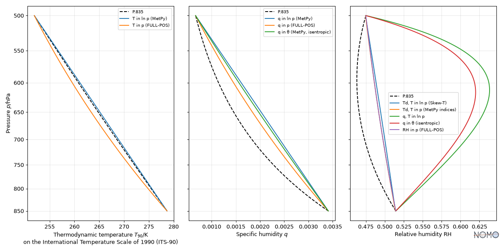

# Vertical coordinates

A value placed in the vertical needs two things: its coordinate, and the
reference from which it is reckoned. WMO puts it this way: "Height,
level or altitude are presented with respect to a well-defined
reference. Typical references are MSL, station altitude or the
1 013.2 hPa plane" (WMO-No. 8, 2024, Volume I, chapter 1).

nomogram gives each coordinate its own quantity kind, defined after a
text in force: the CF standard names, WMO-No. 8 (2024), the IFS
documentation, and for aviation the SERA regulation (EU) No 923/2012,
which takes over the ICAO definitions (the ICAO Annexes are not freely
available). A result feeds an input of its own kind or of one of its
ancestors, never another (see [catalog.md](catalog.md)): coordinates that
look alike but differ by metres never mix silently.

The kinds live in the `atmosphere` family, with their references, and
the terms each community uses in `trade_terms`.

## Which kind for which coordinate

| Coordinate | Kind | Reckoned from | CF standard name | Defined in |
|---|---|---|---|---|
| Altitude (geometric) | `Altitude` (QUDT) | the geoid, about mean sea level | `altitude` | CF |
| Altitude of the surface, elevation of a station | `SurfaceAltitude` | the geoid | `surface_altitude` | CF; WMO-No. 8, Volume I, 1.3.3.2 |
| Height above the surface | `Height` (QUDT) | the surface | `height` | CF |
| Geopotential | `Geopotential` | the geoid | `geopotential` (m² s⁻²) | CF; IFS CY49R1, Part III, equation 2.6 |
| Geopotential height | `GeopotentialHeight` | the geoid | `geopotential_height` | CF; WMO-No. 8, Volume I, equation 12.12 |
| Thickness of a layer | `GeopotentialThickness` | its lower level | `atmosphere_layer_thickness_expressed_as_geopotential_height_difference` | CF |
| Pressure altitude, flight level | `PressureAltitude` | the standard atmosphere | none | SERA, Art. 2, points 101 and 78 |
| Altitude of aviation (altimeter set to QNH) | `AltimetricAltitude` | mean sea level, through the standard atmosphere | none | SERA, Art. 2, point 39, and its GM1 |
| Height of aviation (altimeter set to QFE) | `AltimetricHeight` | the QFE datum, through the standard atmosphere | none | SERA, Art. 2, point 84, and its GM1 |
| Ellipsoidal height (satellite positioning) | `EllipsoidalHeight` | a reference ellipsoid | `height_above_reference_ellipsoid` | CF |
| Geoid height | `GeoidHeight` | a reference ellipsoid | `geoid_height_above_reference_ellipsoid` | CF |
| Pressure of an isobaric level | `Pressure` (QUDT) | | `air_pressure` (narrower) | CF |
| Surface pressure | `SurfaceAirPressure` | | `surface_air_pressure` | CF |
| Pressure at mean sea level | `SeaLevelPressure` | | `air_pressure_at_mean_sea_level` | CF; WMO-No. 8, Volume I, 3.7 |
| QNH, QFE | `AltimeterSetting`, `AerodromePressure` | | none | WMO-No. 8, Volume III, 2.9.1 |

Temperature gradients come in two signs: `LapseRate`, −dT/dz, as CF
defines `air_temperature_lapse_rate`, and `VerticalTemperatureGradient`,
dT/dz; the layers of a standard atmosphere write it against the
geopotential height, dT/dH (ISO 2533, equation 11).

## What never mixes

- **Geopotential height and altitude.** The geopotential height is the
  geopotential divided by the standard acceleration of free fall,
  g_n = 9.80665 m s⁻² (3rd CGPM, 1901). It is numerically close to the
  altitude, and the difference follows gravity, which depends on
  latitude and height (WMO-No. 8, Volume I, 12.5.5.2): 25 m at 8 km and
  220 m at 32 km at 22°N (table 12.10), about 32 m at 8 km at the
  Equator, none near 60°, the geopotential height being the larger
  poleward (equations 12.15 and 12.16).
- **Pressure altitude and altitude.** A pressure altitude is "an
  atmospheric pressure expressed in terms of altitude which corresponds
  to that pressure in the Standard Atmosphere" (SERA, Art. 2, point 101):
  a geopotential height of the standard atmosphere, not of the actual
  one, from which it departs by about 8 m per hectopascal of departure
  from the standard atmosphere near the ground. A sibling of the
  geopotential height, as in QUDT: it feeds neither a geopotential
  height nor an altitude input.
- **The altitude and the height of aviation.** SERA's altitude and
  height are "altimetric rather than geometric" (GM1 to Article 2,
  points 39 and 84): what an altimeter calibrated in the standard
  atmosphere indicates, set to QNH or to QFE. They depart from the
  geometric ones as the actual atmosphere departs from the standard
  one: `AltimetricAltitude` and `AltimetricHeight` feed no altitude or
  height input.
- **Ellipsoidal height and altitude.** Satellite positioning gives a
  height above an ellipsoid; the altitude is about that height minus the
  geoid height, which reaches tens of metres.
- **Lapse rate and vertical temperature gradient.** The same quantity
  with opposite signs: two sibling kinds. One feeds an input of the
  other only through its definition, Γ = −dT/dz (below).
- **QNH and pressure at mean sea level.** The QNH is computed from the
  QFE through the ICAO standard atmosphere, "this virtual atmosphere";
  the pressure reduced to sea level, through a fictitious column of air
  with the actual temperature (WMO-No. 8, Volume III, 2.9.1; Volume I,
  3.7).

## From one coordinate to another

| From → to | Formulation | Source |
|---|---|---|
| geopotential → geopotential height | `geopotential_height_definition`, Z = Φ / g_n | WMO-No. 8, equation 12.12; CF; ERA5 |
| geometric altitude ↔ geopotential height, radius 6356.766 km | `itu_r_p835_geopotential_height`, `itu_r_p835_geometric_altitude` | ITU-R P.835-7, equations 1a and 1b (the U.S. Standard Atmosphere, 1976) |
| geopotential height → geometric altitude, radius 6371.229 km | `era5_geometric_altitude` | ERA5 documentation (the spherical Earth of the IFS) |
| geometric height and latitude → geopotential height | `wmo_geopotential_height_wgs84`, composed of `wmo_geopotential_height_from_normal_gravity`, `wmo_normal_gravity_wgs84` and `wmo_effective_radius_mahoney` | WMO-No. 8, equations 12.15 and 12.16 |
| latitude → normal gravity | `wmo_normal_gravity_wgs84`, `wmo_normal_gravity_smithsonian` | WMO-No. 8, equations 12.16 and 12.14 |
| altitude and surface altitude → height | `height_above_surface` | CF |
| vertical temperature gradient ↔ lapse rate | `lapse_rate_definition`, `vertical_temperature_gradient_definition`, Γ = −dT/dz | CF (`air_temperature_lapse_rate`) |

The conversions differ by their Earth: 10 km of geopotential height are
15.7 m higher geometrically on the sphere of the IFS, a little more on
the smaller radius of the standard atmosphere. For a GPS radiosonde, WMO
takes the latitude into account: 30 km of geometric height give
29.7785 km of geopotential height at the Equator and 29.932 km at 80°N.
WMO's equation 12.13 has the same form as 12.15, with the normal gravity
of 12.14 and an effective radius tabulated in the Smithsonian tables:
`wmo_geopotential_height_from_normal_gravity` takes such a radius as an
input.

## Pressure and height in a hydrostatic atmosphere

| Quantity | Formulation | Source |
|---|---|---|
| pressure at the top of a layer, from its thickness and mean virtual temperature | `wmo_hypsometric_pressure` | WMO-No. 8, equation 12.17 |
| geopotential at the top of a layer, from the pressures and the virtual temperature | `ecmwf_ifs_hypsometric_geopotential` | IFS, Part III, equation 2.20 |
| pressure in a layer of constant temperature gradient | `ussa1976_pressure_layer_gradient` | U.S. Standard Atmosphere 1976, equation 33a |
| pressure in an isothermal layer | `ussa1976_pressure_layer_isothermal` | U.S. Standard Atmosphere 1976, equation 33b |
| pressure reduced to sea level | `wmo_sea_level_pressure`, `wmo_sea_level_pressure_log10` | WMO-No. 8, equations 3.2 and 3.1 |
| dry adiabatic gradient of temperature | `bechtold2015_dry_adiabatic_gradient` | Bechtold (2015), equation 38 |
| dry adiabatic lapse rate | `bechtold2015_dry_adiabatic_lapse_rate`, the same through the definition of the lapse rate | Bechtold (2015), equation 38; CF |

All rest on the hydrostatic equation and the ideal gas law; each
citation records the assumptions its source states. The thickness of a
layer depends on its mean virtual temperature: WMO and the IFS give the
same 5173.9 m from 1000 to 500 hPa at 255 K, to the 3 × 10⁻⁵ by which
their gas constants of dry air differ. The layer formulas of the
standard atmosphere hold for any layer whose temperature varies
linearly with the geopotential height, or not at all: below 80 km, its
molecular-scale temperature is the temperature, and in moist air the
virtual temperature. The unknown of any of them (a thickness, a
pressure, a height) comes by inversion.

The reduction to sea level goes through a fictitious column of air
below the station, of assumed gradient 0.0065 K/gpm, "feasible for
stations below 750 m"; WMO gives it in two forms, which differ by
6.4 × 10⁻⁴ in the exponent, 0.04 hPa for a station at 500 m.

## The reference atmosphere and the pressure altitude

A standard atmosphere is a conventional model, "this virtual
atmosphere" WMO uses to compute the QNH, not a description of the actual
one. Its texts in force are ICAO Doc 7488 and ISO 2533 (1975), neither
freely available; ISO 2533 states itself identical with the ICAO and WMO
standard atmospheres from −2 to 32 km. ITU-R P.835-7 gives the
temperature and pressure up to 84.852 km', derived from the U.S.
Standard Atmosphere, 1976, itself identical to the ICAO standard
atmosphere up to 32 km; its conversion between geopotential and
geometric altitudes, with r = 6 356 766 m, is that of ISO 2533
(equations 8 and 9).

| Quantity | Formulation | Source |
|---|---|---|
| temperature against geopotential height | `itu_r_p835_temperature` | ITU-R P.835-7, equations 2a to 2g |
| pressure against geopotential height | `itu_r_p835_pressure` | ITU-R P.835-7, equations 3a to 3g |
| pressure altitude, in closed form up to 47 km | `iso2533_pressure_altitude` | ISO 2533, Addendum 1 (1985), 2.1 to 2.4 |
| pressure against pressure altitude, its inverse | `iso2533_pressure` | ISO 2533, Addendum 1 (1985), 2.1 to 2.4 |
| temperature against geopotential altitude, −5 to 80 km | `iso2533_temperature` | ISO 2533, equation 11 and Table 4; Addendum 2 (1997) below −2 km |
| temperature, pressure of one layer | `iso2533_temperature_layer`, `iso2533_pressure_layer_gradient`, `iso2533_pressure_layer_isothermal` | ISO 2533, equations 11, 12 and 13 |
| pressure altitude, in feet | `nws_pressure_altitude` | NWS calculation sheet |

Each layer of the pressure is the general form of the U.S. Standard
Atmosphere (equation 33a, or 33b when isothermal) with the values of the
layer, kept as coefficients so that the formula keeps the form P.835
prints. The layers meet with small jumps (226.3206 hPa at the top of the
first, 226.3226 hPa at the bottom of the second). A pressure altitude is
the inverse of this pressure; the jumps make the images of two layers
overlap by a few thousandths of a hectopascal, so the inverse is
numerical, within the 0 to 84.852 km' P.835 states:

```python
from nomogram.catalog import catalog
from nomogram.inversion import invert
from nomogram.model import Variable
from nomogram.units import Q_

altitude = invert(
    catalog().formulations["itu_r_p835_pressure"],
    "H",
    output=Variable("H_p", "PressureAltitude", "KiloM", "Pressure altitude"),
    input=Variable("P", "Pressure", "HectoPA", "Pressure"),
)
at_500_hPa = altitude.evaluate(P=Q_(500, "hPa")).to("m")  # 5574.44 m
```

The formula of the NWS, with rounded constants, gives 5572.10 m at
500 hPa: 2.3 m lower. ISO 2533's Addendum 1 gives the pressure altitude
in closed form, layer by layer from −1 450 to 47 000 m, from which its
hypsometrical tables are printed: 5574.43 m at 500 hPa, 1 cm from the
inversion of P.835. Its pressure against the altitude, `iso2533_pressure`,
is written in the same equations: the two agree within the precision of
their printed coefficients, a few millimetres. The ISO temperature holds
from −2 to 80 km in the standard itself and from −5 to +2 km in its
Addendum 2, which extrapolates the troposphere: two citations, whose
domains add up. The ISO layers (equations 12 and 13) take the specific
gas constant of the standard, 287.052 87 J/(kg K), where the U.S.
Standard Atmosphere writes R*/M_0: a relative difference of 10⁻⁶ in the
pressure at 11 km.

`nomogram.plot.plot_profile` draws such a profile, the vertical
coordinate along y (a pressure downwards on a logarithmic axis, a height
upwards):

```python
import numpy as np

import nomogram as nomo

reference = catalog().formulations["itu_r_p835_temperature"]
heights = Q_(np.linspace(0, 84.852, 400), "km")
profile = nomo.comparison.compare(
    [reference], reference, {"GeopotentialHeight": heights}
)
documentation = nomo.display.DisplayOptions.DOCUMENTATION
ax = nomo.plot.plot_profile(profile, options=documentation)  # extra viz
```

### Physical characteristics of the ISO standard atmosphere

ISO 2533 derives the other characteristics of its atmosphere from the
temperature, the pressure and the acceleration of free fall, for air
"free from moisture and dust" taken as an ideal gas:

| Quantity | Formulation | ISO 2533 |
|---|---|---|
| acceleration of free fall against geometric altitude | `iso2533_acceleration_of_free_fall` | equation 7 |
| air density | `iso2533_air_density` | equation 14 |
| pressure scale height | `iso2533_pressure_scale_height` | equation 16 |
| speed of sound | `iso2533_speed_of_sound` | equation 21 |
| dynamic viscosity (Sutherland) | `iso2533_dynamic_viscosity` | equation 22 |
| kinematic viscosity | `iso2533_kinematic_viscosity`, and `iso2533_kinematic_viscosity_of_air` from the pressure and the temperature | equation 23 |
| thermal conductivity | `iso2533_thermal_conductivity` | equation 24 |

At mean sea level they give the values of its Table 3, such as 340.294
m/s for the speed of sound and 8434.5 m for the pressure scale height.
What the source restricts goes in `conditions`: the speed of sound is
that of an infinitesimal perturbation, not of a shock wave, and
Sutherland's law is "invalid for very high or very low temperatures"
and above 90 km. Equation 7 comes with a precision, 0.001 % up to
60 000 m, which is no validity domain.

## Interpolation between two levels

Each interpolation scheme is a formulation, cited by every source that
uses it: schemes compare like any other formulations. The
post-processing of ARPEGE and the IFS (FULL-POS, which produces ERA5's
pressure levels) chooses the scheme by variable; MetPy and earthkit-meteo
leave the choice to the user, linear in the coordinate or in its
logarithm.

| Scheme | Formulation | Sources |
|---|---|---|
| wind linear in ln p | `log_pressure_interpolation_wind` | FULL-POS (3.2.1), MetPy, earthkit-meteo |
| temperature linear in ln p | `log_pressure_interpolation_temperature` | MetPy, earthkit-meteo |
| temperature linear in p | `pressure_interpolation_temperature` | FULL-POS, ECMWF option (3.2.2) |
| specific humidity linear in p | `pressure_interpolation_specific_humidity` | FULL-POS (3.2.5) |
| relative humidity linear in p | `pressure_interpolation_relative_humidity` | FULL-POS (3.2.5) |
| temperature linear in altitude | `height_interpolation_temperature` | MetPy, earthkit-meteo |
| geopotential height linear in ln p | `log_pressure_interpolation_geopotential_height` | MetPy, earthkit-meteo |

The physics tells them apart. In a layer whose temperature varies
linearly with the geopotential height, as in the ITU-R reference
atmosphere between 850 and 500 hPa, the temperature at 700 hPa is
268.571 K:

| Scheme | At 700 hPa | Error |
|---|---|---|
| temperature linear in altitude | 268.575 K | +0.004 K |
| temperature linear in ln p | 268.886 K | +0.31 K |
| temperature linear in p | 267.208 K | −1.36 K |
| geopotential height linear in ln p | 2963.8 m | −48.4 m |

Linear in the geopotential height, the temperature would be exact; the
scheme takes geometric altitudes, a few metres apart from it here.
The height is linear in ln p only in an isothermal layer (the hypsometric
equation); FULL-POS interpolates instead a departure from a standard
atmosphere, whose own height is computed exactly.

A radiosonde reported in TEMP gives significant levels chosen so that
they alone reconstruct the profiles (WMO-No. 306, Volume I.1, Regulation
35.3.1.3): the temperature interpolated linearly on a T-log P diagram,
that is in ln p, stays within 1 °C of the observed one (2 °C above the
first significant level above 300 hPa or the first tropopause), and the
relative humidity interpolated linearly within 15 points, the coordinate
not stated. Between two such levels, the scheme in ln p is the sounding
itself, to that tolerance. WMO-No. 8 (2024, Volume I, 12.9) asks now for
profiles at 100 m resolution in BUFR, which makes the selection of
significant levels redundant.

## Humidity between two levels

A humidity between two levels depends on the variable interpolated and
on the coordinate it is interpolated in. MetPy 1.7.1, read in its code,
builds no variable of its own for that; FULL-POS, which produces ERA5's
pressure levels, interpolates the humidities linearly in p:

| Practice | Variable interpolated | Formulation |
|---|---|---|
| MetPy, Skew-T and emagram: straight segments drawn between the levels | dew point, linear in ln p | `log_pressure_interpolation_dew_point` |
| MetPy, bounds of a layer (`get_layer`, mixed parcel) | any, linear in ln p | `log_pressure_interpolation_specific_humidity`, `_mixing_ratio`, `_potential_temperature` |
| MetPy, stability indices (K, Total Totals, Showalter; Galvez-Davison) | dew point, mixing ratio, linear in p | `pressure_interpolation_dew_point`, `pressure_interpolation_mixing_ratio` |
| MetPy, isentropic analysis | specific humidity, linear in the potential temperature | `potential_temperature_interpolation_specific_humidity` |
| FULL-POS (3.2.5) | specific and relative humidity, linear in p | `pressure_interpolation_specific_humidity`, `pressure_interpolation_relative_humidity` |

The relative humidity each practice leads to is a formulation of its
own, composed of the schemes and of MetPy's relative humidity, so that
they compare side by side:
`search(kind="RelativeHumidity", keyword="vertical interpolation")`.

| Relative humidity between two levels, from | Formulation |
|---|---|
| dew point and temperature linear in ln p | `metpy171_relative_humidity_dew_point_log_pressure` |
| dew point and temperature linear in p | `metpy171_relative_humidity_dew_point_pressure` |
| specific humidity and temperature linear in ln p | `metpy171_relative_humidity_specific_humidity_log_pressure` |
| specific humidity linear in θ, temperature linear in ln p | `metpy171_relative_humidity_isentropic` |
| ln q and temperature linear in ln p, a scheme nomogram writes without a source | `relative_humidity_log_specific_humidity_log_pressure` |
| relative humidity linear in p | `pressure_interpolation_relative_humidity` |

Between 850 and 500 hPa of the ITU-R reference atmosphere, its profile
composed against the pressure is the truth; each scheme takes the true
values at the two levels, fixed by `nomogram.comparison.partial` so that
the schemes compare along the pressure, as
[`docs/examples/humidity_between_levels.py`](examples/humidity_between_levels.py)
draws them:

```python
from nomogram.comparison import compare, compose, partial

f = catalog().formulations
height = invert(
    f["itu_r_p835_pressure"],
    "H",
    output=Variable("H", "GeopotentialHeight", "KiloM", "Geopotential height"),
    input=Variable("p", "Pressure", "HectoPA", "Pressure"),
)
temperature = compose(f["itu_r_p835_temperature"], {"H": height}, label="P.835")
altitude = compose(f["itu_r_p835_geometric_altitude"], {"Z": height})
density = compose(f["itu_r_p835_water_vapour_density"], {"z": altitude})
vapour = compose(
    f["itu_r_p453_vapour_pressure_from_density"],
    {"rho": density, "T": temperature},
)
mixing = compose(f["metpy171_mixing_ratio"], {"e": vapour})
humidity = compose(
    f["specific_humidity_from_mixing_ratio"], {"r": mixing}, label="P.835"
)
relative = compose(
    f["metpy171_relative_humidity_from_specific_humidity"],
    {"q": humidity, "T": temperature},
    label="P.835",
)
dew_point = compose(f["metpy171_dew_point"], {"e": vapour})

levels = {"p_1": Q_(850, "hPa"), "p_2": Q_(500, "hPa")}
for name, profile in [
    ("T", temperature),
    ("q", humidity),
    ("T_d", dew_point),
    ("RH", relative),
]:
    levels[f"{name}_1"] = profile.evaluate(p=levels["p_1"])
    levels[f"{name}_2"] = profile.evaluate(p=levels["p_2"])


def between(key: str, label: str) -> nomo.comparison.Partial:
    """A scheme or a route, its levels fixed."""
    names = {v.identifier for v in f[key].inputs}
    fixed = {n: v for n, v in levels.items() if n in names}
    return partial(f[key], label=label, **fixed)


temperatures = {
    "log_pressure_interpolation_temperature": "T in ln p (MetPy)",
    "pressure_interpolation_temperature": "T in p (FULL-POS)",
}
humidities = {
    "log_pressure_interpolation_specific_humidity": "q in ln p (MetPy)",
    "pressure_interpolation_specific_humidity": "q in p (FULL-POS)",
    "metpy171_isentropic_specific_humidity": "q in θ (MetPy, isentropic)",
    "log_pressure_interpolation_log_specific_humidity": "ln q in ln p (nomogram)",
}
routes = {
    "metpy171_relative_humidity_dew_point_log_pressure": "Td, T in ln p (Skew-T)",
    "metpy171_relative_humidity_dew_point_pressure": "Td, T in p (MetPy indices)",
    "metpy171_relative_humidity_specific_humidity_log_pressure": "q, T in ln p",
    "metpy171_relative_humidity_isentropic": "q in θ (isentropic)",
    "relative_humidity_log_specific_humidity_log_pressure": "ln q, T in ln p (nomogram)",
    "pressure_interpolation_relative_humidity": "RH in p (FULL-POS)",
}
grid = {"Pressure": Q_(np.linspace(850, 500, 141), "hPa")}
tables = [
    compare([between(k, label) for k, label in schemes.items()], truth, grid)
    for schemes, truth in [
        (temperatures, temperature),
        (humidities, humidity),
        (routes, relative),
    ]
]
documentation = nomo.display.DisplayOptions.DOCUMENTATION
axes = nomo.plot.plot_profiles(tables, options=documentation)  # extra viz
```



At 700 hPa, where the relative humidity of the reference atmosphere is
47.34 %:

| Relative humidity from | At 700 hPa | Error |
|---|---|---|
| ln q and temperature linear in ln p | 47.36 % | +0.03 point |
| dew point and temperature linear in ln p | 50.01 % | +2.67 points |
| dew point and temperature linear in p | 49.76 % | +2.43 points |
| relative humidity linear in p | 49.76 % | +2.43 points |
| specific humidity linear in θ | 59.54 % | +12.20 points |
| specific humidity and temperature linear in ln p | 60.72 % | +13.38 points |

The specific humidity decreases nearly exponentially with height: a
chord between two levels lies above it, and the relative humidity drawn
from it is 12.2 and 13.4 points too high at 700 hPa, up to 15.6 and
17.5 points near 610 hPa. The dew point decreases
nearly linearly, the saturation vapour pressure being nearly exponential
in it: interpolated, it stays within 3 points, as does the relative
humidity interpolated directly. Its logarithm, linear in ln p
(`log_pressure_interpolation_log_specific_humidity`, written by nomogram:
no source was found), leaves the specific humidity 2.5 % too humid at
700 hPa, about 1.2 points of relative humidity, which the temperature
linear in ln p, 0.31 K too warm, takes back: the route lands within
0.03 point there, within 0.07 point over the layer, by compensation.
The relative humidity follows from the variables interpolated, the
temperature as much as the humidity, not from the formula that then
gives it. This
layer, 350 hPa thick, and this humidity, exponential by construction
(P.835, equation 6), magnify the differences: between the close levels
of a radiosonde they shrink, and inversions or dry layers can reorder
them.

### Isentropic coordinates

MetPy brings data onto a surface of constant potential temperature:
the temperature linear in ln p between the two levels around it, the
pressure of the surface found by iteration, then every other variable
linear in the potential temperature of the levels; its docstring says
linear with temperature, its code interpolates in θ. Ziv and Alpert
(1994), whom MetPy cites, compare five relations between temperature and
pressure for the pressure of an isentropic level: against radiosondes,
θ linear in p is the worst, and the temperature linear in ln p (NMC's,
their equation 9 for θ), in height or in p^κ the best; they leave the
other variables aside.
`metpy171_potential_temperature_between_levels` is that potential
temperature against the pressure. On the surface MetPy places at p, the
specific humidity is `metpy171_isentropic_specific_humidity`: the
isentropic curve above is MetPy's, drawn against the pressure rather
than the potential temperature.

Four of their relations give the pressure of the level in closed form;
the source gives no value of R, c_p and g, those of Bechtold (2015) are
taken. Between 850 and 500 hPa of the ITU-R reference atmosphere, the
isentropic level of its 700 hPa (297.38 K) is placed at:

| Relation between temperature and pressure | Formulation | Pressure | Error |
|---|---|---|---|
| (a) θ linear in p | `potential_temperature_interpolation_pressure` | 723.99 hPa | +24.0 hPa |
| (b) θ linear in p^κ | `ziv_alpert1994_isentropic_pressure_exner` | 708.62 hPa | +8.6 hPa |
| (c) T linear in ln p, by iteration (NMC, MetPy) | `metpy171_potential_temperature_between_levels` | 708.39 hPa | +8.4 hPa |
| (d) T linear in height | `ziv_alpert1994_isentropic_pressure_constant_lapse_rate` | 699.85 hPa | −0.15 hPa |
| (e) T linear in p^κ | `ziv_alpert1994_isentropic_pressure_temperature_exner` | 695.62 hPa | −4.4 hPa |

The reference atmosphere has a constant lapse rate in this layer: (d) is
its own profile, within the g of 9.81 m s⁻² it takes. Ziv and Alpert's
equation 15, for (e), prints (p_u − p_d)⁻¹ where their equation 14 gives
(p_u^κ − p_d^κ)⁻¹; the citation records it. Their stability factor
∂θ/∂p, in K/Pa, waits for a quantity kind: QUDT ties that unit to
`PressureBasedTemperature` only.

### Mixed layer

MetPy's mixed parcel mixes a layer: its potential temperature and its
mixing ratio, which an adiabatic mixing conserves, are averaged by mass
(an integral over the pressure), then brought back to a temperature and
a dew point at the pressure where the parcel starts, by default the
first level given (here the surface, the bottom of the layer). The average is a computation on
data, done here with numpy; the rest are formulations. With the first
levels of the sounding of MetPy's docstring and a layer of 50 hPa:

```python
p = Q_([1008.0, 1000.0, 950.0], "hPa")
T = Q_([29.3, 28.1, 23.5], "degC")
rh = Q_([0.85, 0.65, 0.36], "")
e = compose(
    f["vapour_pressure_from_relative_humidity"],
    {"e_s": f["metpy171_saturation_vapour_pressure"]},
)
T_d = compose(f["metpy171_dew_point"], {"e": e}).evaluate(RH=rh, T=T, scale="ignore")
theta = f["metpy171_potential_temperature"].evaluate(T=T, p=p)
r = f["metpy171_saturation_mixing_ratio"].evaluate(p=p, T=T_d, scale="ignore")
# The top of the layer, 958 hPa, from the levels around it, in ln p.
top = {"p": Q_(958, "hPa"), "p_1": p[1], "p_2": p[2]}
theta_top = f["log_pressure_interpolation_potential_temperature"].evaluate(
    **top, theta_1=theta[1], theta_2=theta[2]
)
r_top = f["log_pressure_interpolation_mixing_ratio"].evaluate(
    **top, r_1=r[1], r_2=r[2]
)
# Averages by mass: integrals over the pressure, by trapezoids.
layer = [1008.0, 1000.0, 958.0]
mean_theta = Q_(-np.trapezoid([*theta[:2].m, theta_top.m], layer) / 50, "K")
mean_r = Q_(-np.trapezoid([*r[:2].m, r_top.m], layer) / 50, "")
parcel_t = f["metpy171_temperature_from_potential_temperature"].evaluate(
    theta=mean_theta, p=p[0]
)  # 28.750033 degC
parcel_t_d = f["metpy171_dew_point_from_mixing_ratio"].evaluate(
    p=p[0], r=mean_r, scale="ignore"
)  # 18.1504235 degC
```

MetPy prints 28.750033 °C and 18.1504239 °C: the temperature agrees to
its last digit, the dew point within 4 × 10⁻⁷ K.
`scale="ignore"` evaluates the dew point as MetPy codes it, without
bringing Bolton's coefficients from IPTS-68 onto ITS-90, a few
millikelvins.

## Below the surface

ERA5's pressure levels below the surface are extrapolated by FULL-POS, by
ECMWF's procedure, which Trenberth et al. (1993, NCAR TN-396) document:
the wind and the relative humidity are held at their values of the
lowest model level, and ω too in Trenberth et al., while FULL-POS sets
it to zero (3.2.6); the temperature and the geopotential follow a dry
hydrostatic column of uniform lapse rate, 0.0065 K/m, from a surface
temperature.

| Quantity | Formulation | Sources |
|---|---|---|
| surface temperature from a model level | `fullpos_surface_temperature` | FULL-POS (1); Trenberth et al. (5) |
| temperature below the surface | `ecmwf_temperature_below_ground`, exact `ecmwf_temperature_below_ground_exact` | Trenberth et al. (16, exact 9); FULL-POS (2, 3) |
| geopotential below the surface | `ecmwf_geopotential_below_ground`, exact `ecmwf_geopotential_below_ground_exact` | Trenberth et al. (15, exact 10); FULL-POS (6) |
| mean sea level pressure | `fullpos_mean_sea_level_pressure`, exact `ecmwf_mean_sea_level_pressure_exact` | FULL-POS (8, 9); Trenberth et al. (12, exact 11) |

The operational forms are third-order expansions of the exact ones: under
a surface at 850 hPa and 280 K, they stay within about 10⁻⁵ K, 2 mm and
0.002 hPa of them at 1000 hPa. The reduction to sea level agrees with
WMO's (equation 3.2), which assumes the same gradient. Over very warm or
cold surfaces, and above 2000 m, both sources change the gradient: these
cases are not entered.

The FULL-POS documentation prints log(Π_s/Π_L) in its equations 3 and 6,
which would make the extrapolated column colder and higher than the
surface. Its own equations 1 and 8 take the pressure ratio the other
way, lower level over upper, with a positive gradient of 0.0065 K/m;
Trenberth et al. give ln(p/p_s), the form entered. The citations say so.

## One word, several quantities

| Term | Community | Kind | Source |
|---|---|---|---|
| geopotential | CF, the IFS | `Geopotential`, in m² s⁻² | CF; IFS, Part III |
| geopotential | WMO upper-air observations | `GeopotentialHeight`, in standard geopotential metres | WMO-No. 8, Volume I, chapter 1 |
| altitude | aviation (SERA) | `AltimetricAltitude`, from mean sea level, altimetric | SERA, Art. 2, point 39, and its GM1 |
| altitude | CF | `Altitude`, from the geoid | CF |
| height | aviation (SERA) | `AltimetricHeight`, from a specified datum, altimetric | SERA, Art. 2, point 84, and its GM1 |
| height | CF | `Height`, from the surface | CF |
| elevation | WMO surface observations | `SurfaceAltitude` | WMO-No. 8, Volume I, 1.3.3.2 |
| flight level | aviation (SERA) | `PressureAltitude` | SERA, Art. 2, point 78 |

Symbols differ too. WMO-No. 8 writes z for the geometric height and Z
for the geopotential height (12.5.5.2); ITU-R P.835 writes H for the
geopotential height and Z for the geometric height; the IFS writes φ for
the geopotential, and ERA5 z for it and h for the geopotential height. Each formulation keeps its source's symbols in the
notation of its citation.

## Units

There is no geopotential metre in nomogram: a geopotential height is in
metres, the kind carrying the meaning. WMO's standard geopotential
metre, "0.980665 of the dynamic metre", gives the same numbers as
Φ / g_n in metres. ISO 2533 dates it: 9.806 65 m² s⁻², adopted by WMO
from 1 July 1972 in place of the geopotential metre of 9.8 m² s⁻², whose
numbers differed by 0.07 %. Pressure altitudes may be in feet.

## In ERA5 and the IFS

The IFS takes the Earth as a sphere of radius 6371.229 km. ERA5 refers
heights to the EGM96 geoid over land and to mean sea level over the
ocean, assumed to coincide with the geoid; its geopotential height is
the geopotential divided by 9.80665 m s⁻², "a fixed value in the IFS"
(ERA5 data documentation and its page on computing heights). ERA5
follows the documentation of IFS cycle CY41R2; the equations used here
have the same numbers in CY49R1 and CY50R1.

## Search

`search("geopotential height")`, a CF name (`geopotential_height`) or a
Wikidata item (`Q12432978`) finds the kind; a term (`search("flight
level")`) finds the trade term, whose meanings name the kinds;
`search(family="atmosphere")` lists the family; `used_by` on a reference
(`references.sera2012`) lists what it defines. The keywords
`vertical interpolation`, `isentropic` and `mixed layer` find the
schemes and what is built from them, and `search(source="metpy171*")`
what MetPy's code was read for.
